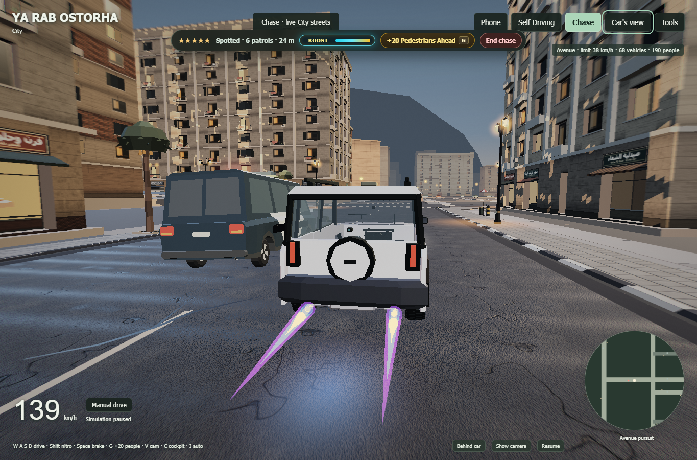
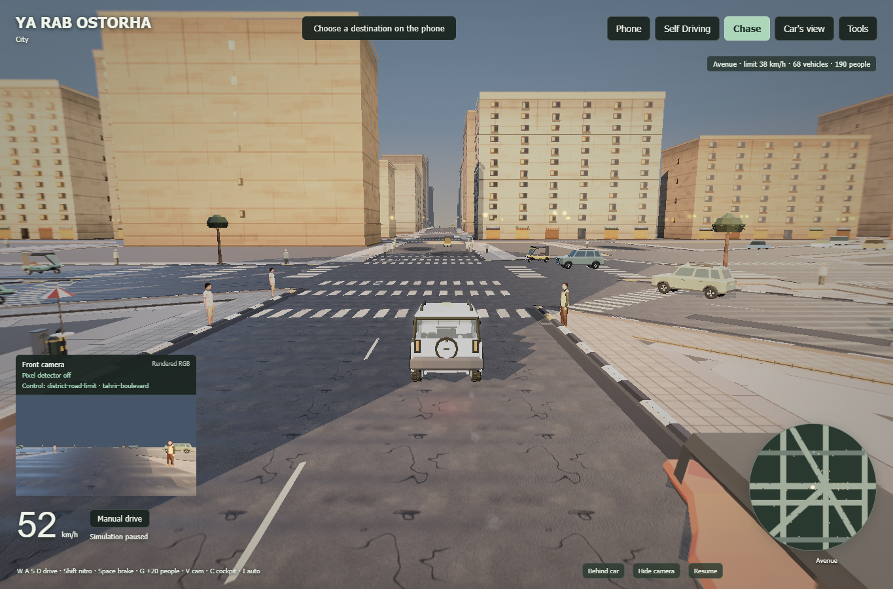
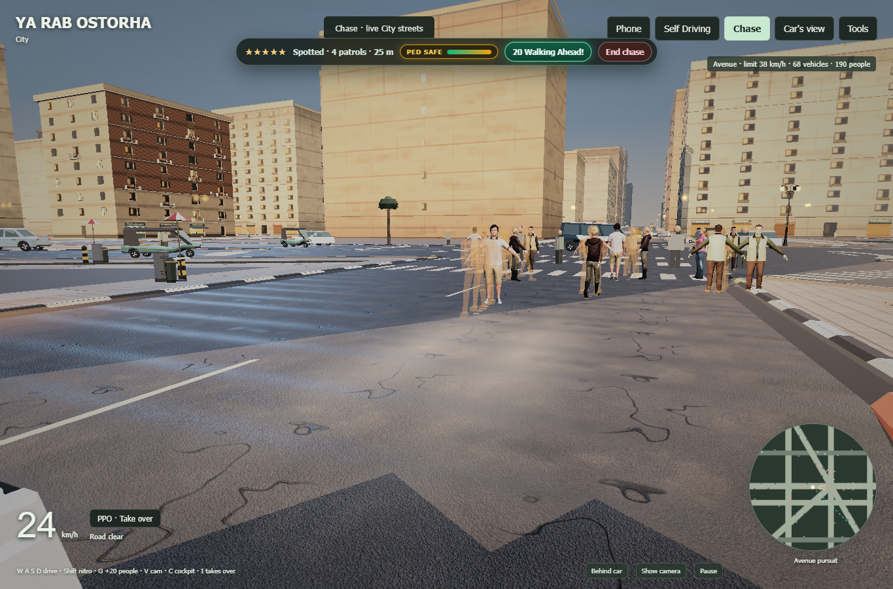
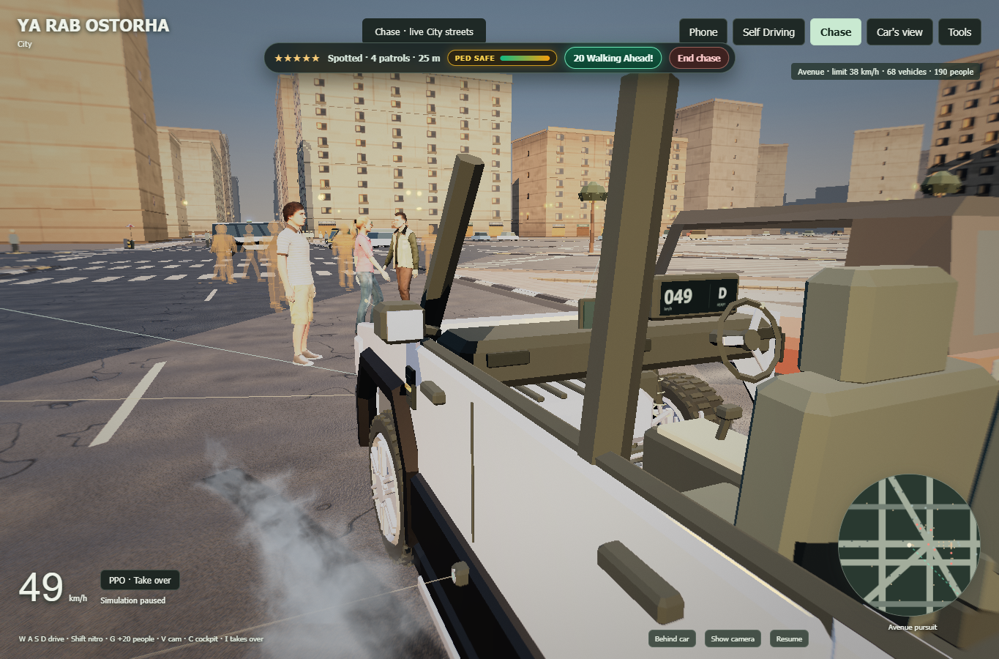
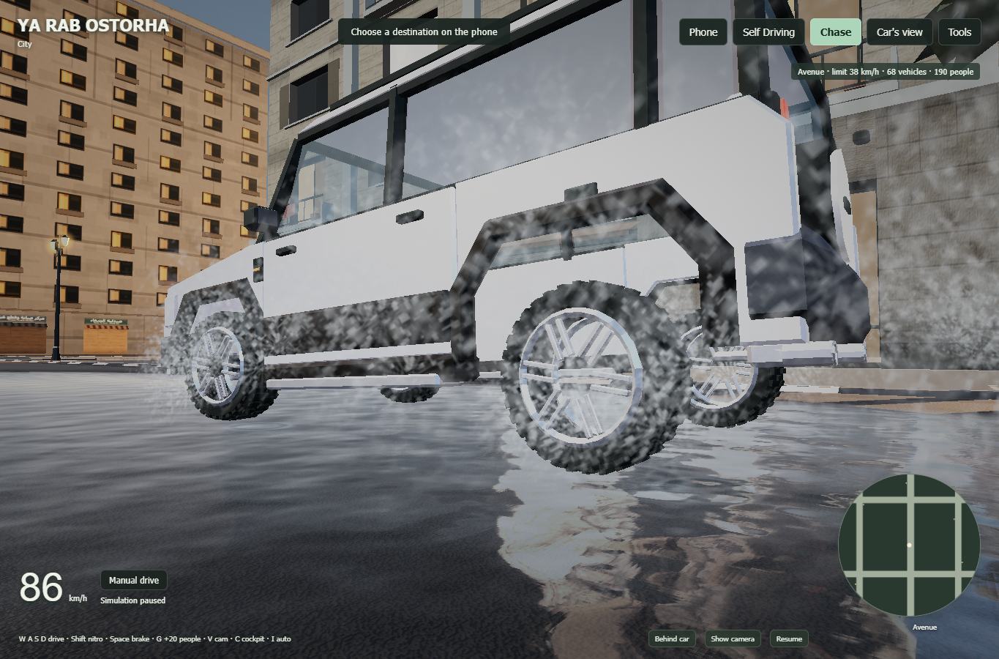
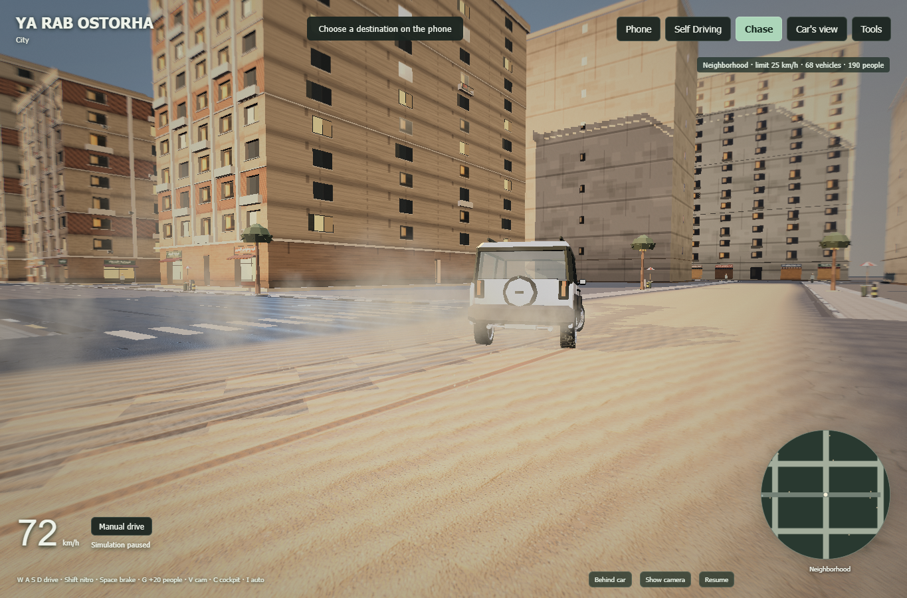
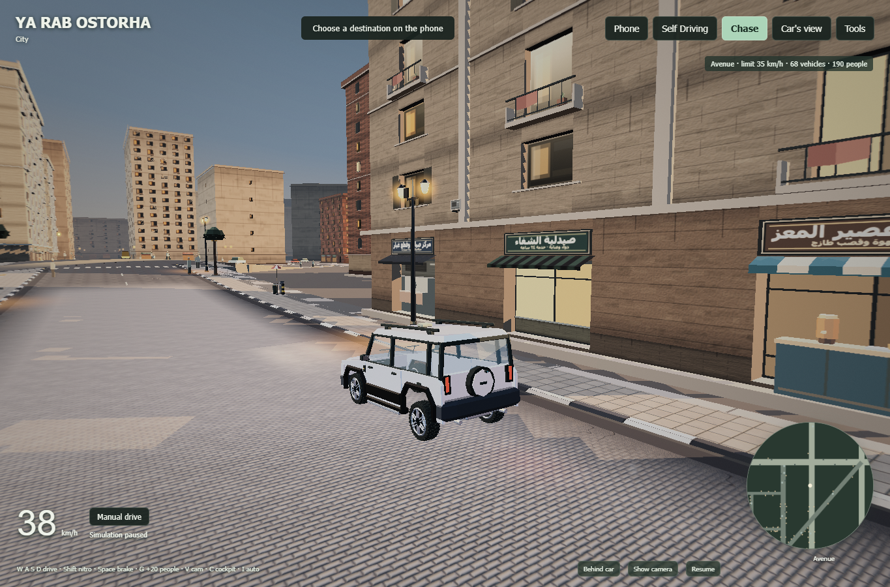
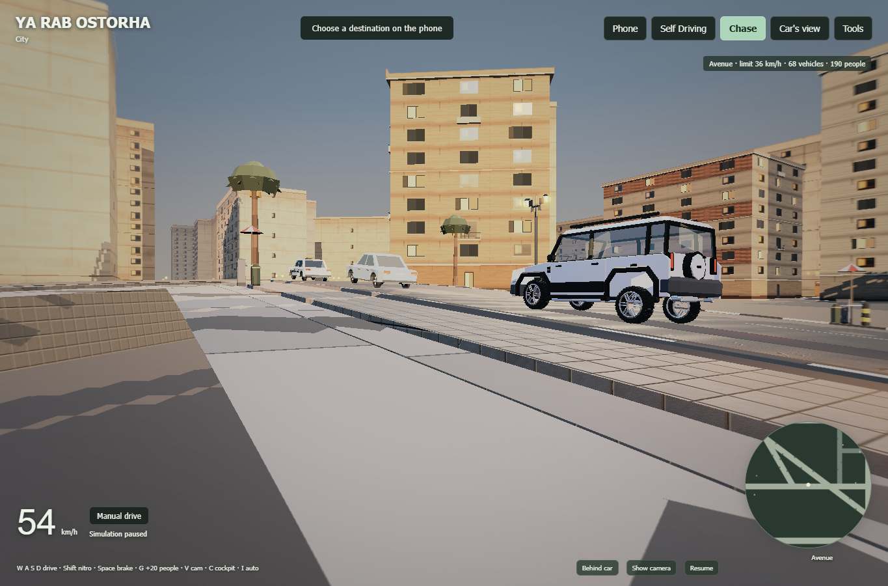
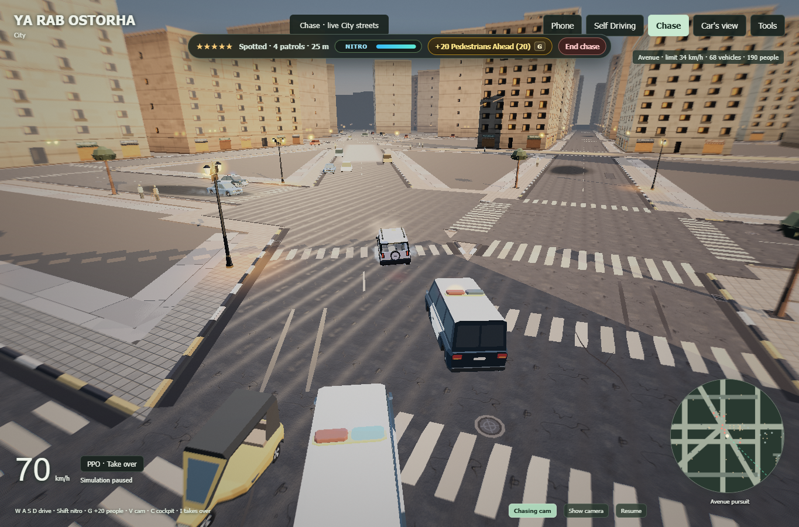
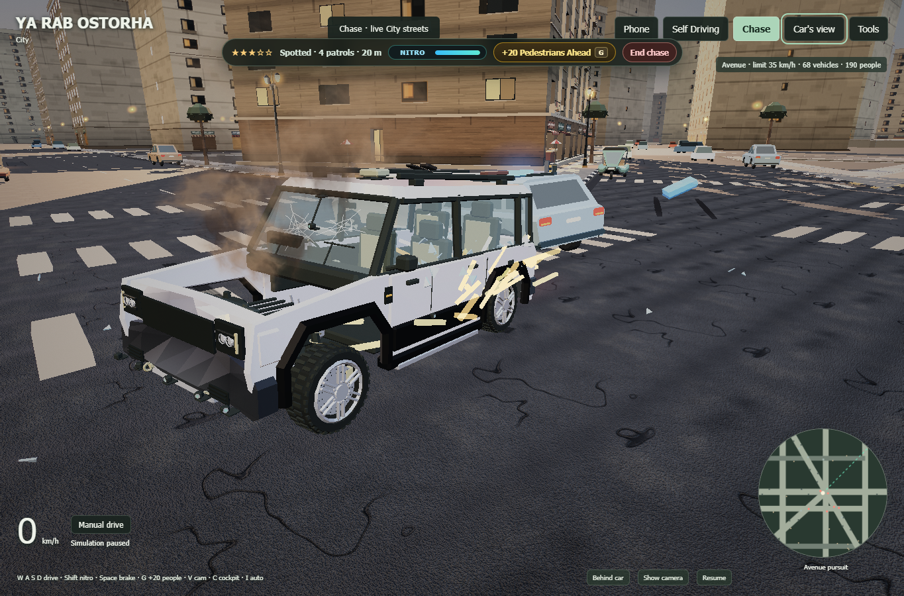

# YA RAB OSTORHA: standalone Three.js driving game

**This is the active project on `main`. No CARLA, GTA, BeamNG or other external
simulator is required or started.** The city, vehicle motion, traffic,
pedestrians, road graph and driving controls run in the browser with Three.js.
Continue this version rather than the historical native integrations below.



### Live Gameplay & Surface Showcase (Grand Metro City v5 — Ultra-Smooth 60+ FPS)

| Bright Cairo Avenue Cruising (`45+ km/h`) & Pearl-Silver SUV | 5-Star Chase & Nitro Boost (`138+ km/h`) |
| --- | --- |
|  |  |
| **`+20 Pedestrians Ahead` & 3D Forecast Ghosts (`PED SAFE`)** | **Cockpit, Body Cutaway & Mounted Virtual Sensor Inspection** |
|  |  |
| **Standing Water Puddle Hydroplaning & Fresnel Splash** | **Sandy Street Drift, Carved Ruts & Desert Silt Billows** |
|  |  |
| **Historic Cobblestone Market & Cairo Storefronts (`العمارات والمحلات`)** | **Elevated Ramses Flyover (`2.9 m` Embankment) & Climbing Grade** |
|  |  |
| **Elevated Chasing Camera Over Diagonal Boulevards** | **Real 17-Part Physical Crash, Detached Parts, Sparks & Smoke** |
|  |  |

## Run the game

Requires Python **3.10+** on PATH and a WebGL-capable browser. The checked-in
browser bundles and runtime models work without Python packages, AI weights or
a simulator installation:

```powershell
.\Start-YA-RAB-OSTORHA.ps1
# Or double-click Start-YA-RAB-OSTORHA.cmd.
# Terminal-only alternative:
python -m backend.threejs.server
```

Open <http://127.0.0.1:8000/>. `Run-Project.ps1` and `npm start` use the same
standalone server. `-Check` checks local files without starting a server;
`-NoBrowser -Port 8766` selects an isolated terminal-only instance. A busy port
fails visibly; the launcher never reuses or stops somebody else's server.

| Control | Action |
| --- | --- |
| WASD / arrow keys | Manual driving and steering |
| Space | Brake and take manual control |
| I / Manual drive button | Toggle autonomous driving |
| P / Phone | Choose an Arabic destination from the place buttons |
| C | Cycle behind car / in-cabin driver / elevated chasing camera |
| Tools → Car | Choose the player vehicle, inspect its running gear, cabin and mounted virtual sensors |
| Camera | Inspect the actual vehicle-front pixels, exact-frame recognition and observed-motion forecast |
| People | Inspect real human bodies and explicit world-reference walk/jog/stop controls |
| Self Driving / Chase | Drive autonomously, or pick a pursuit difficulty (`Level 1` to `5 · Max`) and watch the preloaded RL PPO driver evade visible police across roads and clear curbs (or toggle `Manual` / press `I` to drive yourself) |
| Car's view | See all-around virtual range returns, exact front-camera recognition and translucent pedestrian forecasts |
| Tools | Open Settings, Decision lab, the Lab or the preserved experimental chase variants |
| Return to city | Resume the same City after a Lab or inspection visit |
| Pause / Resume | Pause and resume the browser world |

Place buttons work without an NLP model. Typed/voice NLP and the explicitly
started local camera perception worker are not prerequisites for manual driving. The front
view is a rendered game camera, not real-world sensor footage. No model or
training process is started by the default server. Microphone input is not
needed. The game is an unfinished prototype, not a validated physical simulator
or a road-safety guarantee.

## Player car

The default player vehicle is an original **matte, visibly faceted off-road SUV**, inspired by
the upright boxy proportions of Jetour T2 and styled to belong beside the
game's existing low-poly traffic. It is not a branded replica or the earlier
reflective sports-car model. Its body, cabin and running gear are authored
locally in `src/render/suv-model.js`; the player needs no downloaded car model.
Historical assets and their notices remain preserved.

In **Tools → Car → Player vehicle**, choose **King Long · Microbus** to drive
the white, short-nose Egyptian-market-style microbus. Its white high roof,
sliding passenger door, dark side windows and road wheels are procedural 3D
geometry, not a reskin of the Jetour-inspired SUV. Stop in a clear spot to
switch; the same City, street position and ambient actors remain in place.
Choose **Jetour T2 · SUV** to return to the original vehicle.

The microbus has a longer and narrower collision footprint (**4.84 × 1.70 m**),
smaller tires (**0.315 m radius** versus the SUV's **0.35 m**), a heavier plant,
slower acceleration, a wider turning response and more suspension roll.
These are game values, not manufacturer specifications. WASD, **C** camera
cycling, cockpit, inspection and normal destination driving are available.
Standard **Chase** is manual with the microbus; the preloaded PPO and the
legacy experiments remain SUV-only. See the [25 live gameplay frames](docs/screenshots/king-long-microbus/README.md).

The **Car** panel is limited to the player vehicle. Chase and left-hand cockpit views
remain drivable. Inspection and running-gear views pause the world and allow
mouse orbit/zoom; returning to a driving view restores the previous pause state.
Cutaway exposes the cabin and mechanical structure. The steering wheel, front
wheel angles, signed tire rolling and bounded suspension/load response follow
the fixed-step vehicle state, not independent decorative animations.

The SUV has opaque black exterior privacy glazing: cabin details are hidden
from outside, while outward-facing panes leave the cockpit and mounted camera
views unobstructed. **C** cycles behind car, cockpit, elevated chasing camera,
then behind car again; **V** still toggles the two exterior driving cameras.

The SUV now has staggered tread and shoulder lugs, open split-spoke wheels with
visible brake discs and lug hardware, shaped hood creases, recessed grille and
projector details, lower intakes, windshield wipers, under-hood mechanical
assemblies (radiator core, front crash bar, battery box, coolant hose), front
tow hooks, fender vents with amber repeaters, reflective mirror glass, dual
rear exhausts, license plates, a high-mount brake lamp, and cockpit pedals and
center display. Wheel detail shares geometry across all four corners and
follows the existing steering/rolling assemblies; calipers stay fixed to the
uprights. Nearby traffic and police cruisers receive recessed grilles, bumpers,
lamps, mirrors, trim, and wheel hubs, and visibly crumple when struck.

Five front-bumper, three rear and two side proximity units use shared local
metre-space mounts. The front and rear RGB camera selection changes the actual
rendered feed, keeping debug rays, glass-crack lines and crash particle plumes
out of the sensor camera render pass. Sensor visualization displays the measured geometry rays;
the roof IMU/GNSS enclosure reports explicitly virtual vehicle-state telemetry.
These are not hardware radar/lidar, satellite fixes or neural detections.
The existing five filtered front readings remain compatible with their
consumers. Ordinary city collision avoidance remains enabled.

**Vehicle test bay** enters a separate car-only instance of the existing lab
roads, offering both the standard **Run impact** (**5–6 m/s**) and **Heavy crash
(50 km/h)** (**15 m/s**) barrier runs alongside a live **Body & parts**
component readout in the Car panel. Collisions in the bay and in City/Chase
drive localized 17-part component damage—hinging or detaching the hood to
expose the radiator bay, unclipping/crushing bumper corners while retaining the
bolted lower skid flange, detaching the grille, mirrors, plates, spare cover or
exhaust, swinging struck doors ajar, shattering lamps, cracking glazing, and
spawning pooled 3D tumbling car parts, glass shards, sparks, and radiator steam
or engine smoke—while remaining a bounded procedural damage approximation
rather than a finite-element crashworthiness model. **Repair / reset** restores
pristine geometry, transforms and state in place and clears active player
debris. **Return to city** restores the original paused city rather than
replacing it with the test.

The vehicle remains a bounded game-physics approximation, not a calibrated
tire, suspension, crashworthiness or real-road safety model. No external
simulator or optional model process is needed for this work.

New default City runs record `vehicleDynamics: "city-realism-v1"`. Acceleration,
braking and cornering share an **8 m/s²** grip budget rather than allowing
unbounded bicycle-model cornering at high speed. A glancing vehicle/static
contact removes closing motion while retaining dissipative tangential sliding;
damage uses normal closing speed and effective mass, and continuous scraping
counts as one impact episode. Other actors remain kinematic, not a full
two-way rigid-body solver. Historical City recordings without this profile
and the preserved pursuit contact rules keep their previous dynamics.

## Vision-first driving and Egyptian streets

**Vision lab** exercises real front-camera pixels, the existing local YOLOX-Tiny
detector and a lightweight observed-motion crossing forecast. Its braking cap is
separate from the independent safety guard; sensors support the experiment
rather than supply hidden actor truth to the visual predictor. Crossings from
both sides are checked against similar noncrossing and missing-camera cases.
The existing saved Q/GRU policies are not treated as pixel-native models or
declared universally worse than the chosen decision path.

The city facade/street layer uses existing registered footprints and locally
authored Egyptian shopfront, plaster/brick, balcony and roof details. The current
SUV, virtual sensor mounts, manual controls, city navigation and isolated car
fixture remain part of the same standalone game.

City surfaces now include recessed brick mortar, fine plaster relief, smoother
window/shutter finishes and varied asphalt/pavement roughness. In Grand Metro
City v5 (`terrainProfile: "cairo-surfaces-v1"`), boulevard and neighborhood
apartment towers (`العمارات`) stream full-height 3D balconies, split AC outdoor
units, louvered shutters, rooftop water tanks/satellite dishes, and ground-floor
commercial storefronts (`المحلات`) with sloped awnings, illuminated dusk
vitrines, and Arabic signage, paired with instanced street lamps + warm dusk
ground light pools, slotted cast-iron tree grates with muted olive foliage,
electrical feeder cabinets, and sidewalk furniture inside the streamed GPU
budget. Streets and sidewalks use `512×512` procedural PBR dark coarse bitumen
asphalt (tire-wear polish ruts, tar crack seams, cast-iron manholes) and
recessed-mortar Cairo sidewalk tiles, bordered by 3D segmented weathered
charcoal-and-stone Egyptian curb blocks (`بلدورة الرصيف`) and storm-drain
grates. A moody twilight Cairo sky dome, low-fill raking sun shadows, and a
single-pass MSAA WebGL film grade (`src/render/cinematic-post.js` — dark
exposure, filmic S-curve contrast, selective desaturation preserving police
strobes, cold-shadow/warm-highlight split-toning, anamorphic vignette, and
peripheral speed streaks) grade the main display viewport while leaving AI
`visionCamera` / `frontCamera` RGB streams ungraded. Both **Behind car** and
**Chasing cam** drive speed/G-force reactive FOV, horizon Dutch-angle banking,
throttle/brake boom inertia, and road-roughness micro-vibration alongside
sub-frame `alpha`-interpolated SUV suspension and projected headlamp/brake road
pools. Roads follow a smooth `C²` 3D elevation field of overpass ramps and
district ridges with retaining walls, plus Schlick-Fresnel semi-transparent
standing water puddles (`roughness 0.045`, live wind micro-ripples, expanding
tire-wake concentric ripples, wispy FBM spray billboards, and 15 m decaying wet
asphalt tire tracks), rippled sand stretches (`roughness 0.94`, persistent
4-wheel carved sand ruts, volumetric FBM dust billows, and ballistic grit), and
cobblestone/curb zones that physically govern tire grip, sand rolling drag, wet
braking/hydroplane slip, slope gravity (`-g sin(grade)`), and suspension
chatter. Live `interactionProfile: "wheel-scrub-v1"` (`src/core/wheel-interaction-physics.js`)
models shallow curb-grazing sidewall drag & aligning yaw deflection, wheel-by-wheel
manual curb climbing, Coulomb sideswipe friction & contact-patch pivot yaw
deflection, `WeakMap`-backed two-body rocking on struck/sideswiped vehicles, and
camera-facing FBM volumetric engine/tire/scrape smoke billboards + asphalt skid
ribbons (`src/render/crash-effects.js`). Historical City replays without
`terrainProfile` / `interactionProfile` retain flat legacy dynamics. The detail
maps are generated locally and shared by the streamed facade batches; sun
shadows follow actual light-space texels instead of jumping on a coarse
two-metre grid.

See [the exact data boundary, existing model measurements and experiment
limits](docs/VISION_FIRST.md). No new model or package is downloaded automatically;
missing local perception requirements are an explicit unavailable state.

## Camera and embodied people

**Camera** opens a larger evidence workspace without replacing the city. Raw
preview does not silently start a model. Explicitly start the installed detector
to compare the same actual JPEG with its recognition and observed-motion
interpretation. Frame/source/age, detection scores, fitted motion and the
applied vehicle action remain distinct. Missing, stale or mismatched evidence
is unavailable, not a confident clear road. No text/OCR reading or knowledge of
private human intention is claimed.

**People** is a separate **World reference, not perception input**. Select and
follow an existing articulated local human, inspect its body and actual motion,
and request ambient, walk, jog or stop. Ordinary speed/turn transitions are
bounded and gait follows accepted displacement rather than an independent
walking loop. Return to the vehicle view without replacing the city. These are
grounded kinematic game humans, not calibrated biomechanics or ragdolls.

[The portable core feature map](docs/GAME_CORE_FEATURES.md) identifies what was
retained or reused from the earlier work and what remains engine-specific.

## One connected city

The game opens directly in **Grand Metro City (`cityVersion: 5`)** (`~960 × 800 m`, `> 765,000 m²`, preserving `cityVersion: 1..4` for deterministic legacy tests and replays). Broad boulevards, **5 diagonal radial avenues & market slash streets** (`qasr-diagonal`, `talaat-diagonal`, `ramses-diagonal`, `bazaar-slash`, `citadel-diagonal`), monumental multi-story Egyptian buildings (`28–56 m` tall), **66 curbside parked vehicles**, **190 default street pedestrians** (configurable up to **280** with 3-tier CPU & skeletal render LOD for 60+ FPS), traffic convergence hubs, warm golden streetlamp pools, and a player-following street key light illuminating the Pearl-Silver Clearcoat SUV (`CITY_CLEAR_CINEMATIC_GRADE`) share one road graph, traffic population, and set of Phone destinations. Switch live between the grounded **Behind car** camera and the dynamic speed-reactive **Chasing cam** using the HUD camera button (`Behind car` / `Chasing cam`), the Chase card toggle, or **V**. **C** cycles behind car, cockpit and elevated chasing views.

Use **Chase** on the main toolbar to pick a pursuit level (`Level 1` up to `5 · Max`) and press **Start chase** on the same City streets:
- The existing **RL PPO checkpoint** (`public/threejs/pako-chase-ppo.json`) proposes actions, while the default **`pako-smart-escape-v3`** sensor-only planner adds a persistent reachable escape destination, observed-velocity traffic forecasting, committed crossing yields and bounded steering changes (`RL AI` vs `Manual`, or **I** / **WASD** to take over). These deterministic planning changes are not a claim that the shipped neural checkpoint was retrained.
- Default **`city-fair-v1`** police occupy stable City road beats, acquire through actual visibility and share last-known reports. They do not recycle or continuously spawn ahead of the moving SUV. Every difficulty caps patrol speed at the SUV's **unboosted** maximum, including NPC speed multipliers; Nitro gives the player a speed advantage. Unversioned replays and experimental legacy pursuit settings retain their original rules.
- **Ultra-smooth zero-hitch simulation & rendering**: spatial-indexed `PursuitScanner` ray prefilters (`~0.22 ms`/scan), `WeakMap`-cached tactical road & scene-node lookups, `32 m` spatial surface cells with zero-allocation wheel scratch buffers, dirty-tracked bounded GPU instanced uploads (`0` idle buffer uploads on dry/calm frames), single-pass volumetric smoke billboarding, and pooled traffic crash-deformation VBOs sustain **73–86+ FPS** across 210-pedestrian 5-star Chases, standing water puddle splashes, sandy street drifts, and multi-car part-detaching pileups.
- **Rechargeable Nitro Boost (`NITRO_SPEC`, up to `38.5 m/s`)**: faster than 5-star police interceptors, complete with twin 3D rear afterburner flames and a live `#chaseNitroMeter` HUD bar (**Shift** / **N** or touch **NITRO** in manual mode). In autonomous RL Chase, the sensor-only controller engages Nitro on clear straightaways (`>= 30 m` clear scan) to break police containment and **unconditionally inhibits Nitro (`PED SAFE`)** the instant any 360° range ray, tracked motion vector, or camera forecast detects a pedestrian in the forward safety corridor.
- **Live `+20 Pedestrians Ahead` Test Button (`#spawnCrowdAheadBtn` or `G`)**: adds all 20 walking pedestrians without removing the ambient population or previous waves. The new **`dispersed-cohorts-v1`** layout staggers groups over a longer road corridor with a connected passing gap instead of forming a solid wall. A genuinely blocked corridor reports failure atomically, retaining everybody already present. The scan/camera forecast ghosts and `PED SAFE` Nitro hold remain active.
- **City-wide curb & courtyard support** (`metro-city-curbs-v2`, 316 surveyed orthogonal + diagonal sidewalk spans and interior courtyard blocks) and **sensor-only path-changing evasion** (`pako-evasive-v2`) let the SUV anticipate closing vehicles `24–40 m` ahead, weave smoothly through curbside parked-car chicanes, yield or steer around dense walking crowds, hop clear sidewalks, cut through open alleys between buildings, or execute fast 2-phase reverse pivots from 360° range rays, surface tracks, and front-camera forecasts.
- Use **Train & test** inside Chase to run multi-episode PPO updates in the background Worker, watch full actor replays, and apply updated checkpoints directly back into City Chase.

New City v5 runs also enable **`solid-city-props-v1`**: all 523 authored street
trees and the existing market kiosk have shared physical/render descriptors.
Normal and Chase impacts use real swept contact, damage and tangential sliding.
Trees bend above a rigid lower trunk; kiosk upper structures crumple above a
solid counter. Their fixed lower collision hulls remain valid after impact.
Streaming a mesh out never removes its collider. Old replays explicitly retain
their previous decorative-only prop profile.

Fresh Chase training includes `smart-gap-crowd`, `smart-crossing-traffic` and
`smart-static-hazard` scenarios on these same City roads; compatible saved
checkpoints retain their original curriculum identity. Controlled two-seed
crossing/static/crowd comparisons reduced six old-controller contacts to zero,
with slower crowd throughput rather than a universal speed or zero-crash claim.
The shipped PPO still did **not** achieve a qualified escape in three dense
120-second evaluations: two timed out and one was captured, with 0/0/2 contacts.
Traversing the entire newly spawned crowd is also **not verified**. A bounded
240-transition PPO update exercised the new training scenarios, but did not
establish a learned improvement; its development checkpoint is not shipped.
`node tools/verify-smart-city-escape.mjs` deliberately keeps these unmet escape
criteria failing instead of treating survival or stopping as success.

The full JavaScript suite also has pre-existing Windows-native harness failures
on Linux (`python.exe` and Windows-only process-tree cleanup); it is not a
green cross-platform acceptance result. The standalone game does not require
that native harness.
See the [25-frame live City gallery](docs/screenshots/smart-city-escape/README.md).

Use **Tools → Experiments → Arcade chase → Start pursuit** to start the original arcade variant on the
street you are already on. The same city, original SUV and civilian actors
keep running. Two cruisers open the chase, then backup joins from available
streets, including heavier vans. Patrol collisions produce wrecks. The raised
chase view shows the space between them; **C** still switches to the cockpit.
Losing the patrols can still reduce the five-star wanted meter and end the chase.

The SUV starts self-driving. Press **I** to take over with automatic throttle,
**A / D** or the arrows to steer and drift, and **Space** to brake. The equivalent
touch controls appear on smaller screens. Collect **Giant** or **Ghost** for
a temporary benefit; **Mine** and **Pulse** give one charge behind or ahead,
used with **E** or the **Use** button. Giant can clear patrol cars on contact,
but the larger SUV accelerates more slowly and needs more room to turn.
It cannot clear civilian vehicles or pedestrians. Ghost cannot phase
through people or buildings. Real contact ends the round and plays a short slow-motion review.
**R** or **Run again** restarts from the current street. **Sound on/off** toggles
the local music and effects, and the same browser keeps the best time.

Choose **Tactical / training** in the City pursuit panel to use the previous
weight-training setup. Start in **Lab → Pursuit drills** to practice an evasive turn, a light patrol
contact, a safe crossing, or a close pedestrian impact. Check **Train on this
drill** to update the maneuver policy from actual outcomes. In City the default starts with
hand-authored weights, and the driver can back out and turn if that full
movement checks out. **Use Lab policy** uses the Lab weights without changing
them; **Learn from this chase** improves the City weights and saves them in the
current browser after the run. **I** or **Space** takes manual control and
suspends learning.

The HUD distinguishes **Yielding to pedestrian**, **Crossing clear**, and a
real contact. Braking and yielding do not incur a contact penalty. Continuing
into an unsafe stopping gap costs reward; a real contact triggers the
non-graphic impact pose and costs more at a higher closing speed.

**End pursuit**
removes the patrols and their temporary barriers, not the existing traffic.
The active trip is replanned from the current pose when possible; if no legal route is
available from that heading, choose a destination again.

See the [PAKO Forever / GTA V comparison and implementation checklist](docs/CITY_PURSUIT_REVIEW.md)
for the decisions behind this mode.

Under **Tools → Experiments**, **GTA Chase** is a separate manual variant on the same City streets.
Select the opening wanted level (1–5); use **W / S** for throttle or reverse,
**A / D** to steer, and **Space** to brake. Impacts can shove or damage cars
without ending the chase on the first hit. Higher heat brings faster units,
heavy vans, and temporary roadblocks. End the chase without resetting traffic.

Under **Tools → Experiments**, **Metro Dispatch** is the original manual ruleset on those same
streets. Police share reports while your SUV is inside a surveillance zone.
Outside coverage they need a sighting to update your position; the HUD shows
the current tracking state and Chase diagnostics lists the active zones. Losing
sight is not enough: escape requires prior active pursuit and separation.
The opening squad uses checked berths, and high-tier patrols cannot start a
head-on approach inside the opening reaction window. Dispatch must have a
current report and an unoccupied, drivable turn before it can place a concealed
roadblock beyond that turn. Traffic can still close the detour later.
New Dispatch runs dent the struck panel on a fresh impact, even while the SUV
is stopped. Staying in the same contact does not add another dent. Older
recordings retain their original damage feedback.

**Metro Dispatch · PPO** loads a locally selected experimental checkpoint.
It displays the checkpoint hash, never starts without a compatible model, and
hands control back on **I**, **Space**, or manual driving input. It is not the
ordinary City autopilot. The frozen driver completed a five-star development
run in the full-density City without an SUV contact, but other actors still
collided and the untouched acceptance suite has not been run. The brake guard
checks a requested turn around a measured stationary vehicle; it does not
choose the route or certify safety.
In **Lab → Settings → PAKO Training and Testing → Single-update tools**,
train one update at a time with the same rollout and optimizer as the CLI.
The main flow is **Chase → Difficulty → Start chase**. With no selected PPO
checkpoint, you drive. Load a compatible file explicitly, or choose **Use
checkpoint in Chase** after training, to watch the AI drive in development
testing. The panel labels an unverified checkpoint **PPO test**. Unified City
**Chase** activates `gta-tactical-v1`: privileged faster cruisers/interceptors
(`33.5–38.0 m/s`), lane-breaking civilian overtakes, curb/courtyard pursuit,
dynamic wanted escalation up to `5★` (`14` active units), 3D building-occluded
GTA line-of-sight + large-distance (`86–110 m`) or alley-cover (`≥ 52 m`)
one-by-one star decay, cross-city escape sector objectives (`≥ 450 m` away in
Grand City v5 so the AI drives purposefully across distant districts), realistic
speed-sensitive steering & cornering suspension dynamics, golden-hour player-
tracking 3D lighting + police siren light bounce, and a heavily blurred
cinematic lens-wash Red & Blue pursuit strobe that calms down when out of sight.
Legacy `dispatch-v1` runs retain their original rules.

**Chase → Train & test** selects a full City workload at that level, with a
120-second episode deadline. It separates qualified clean escapes, other
terminal outcomes, and actual contacts from PPO updates and transitions.
New Chase sessions award the escape bonus only if the SUV made no contacts.
Existing checkpoints resume with their original reward rules. Testing freezes
the weights. Controls for limits, parallel worlds, and
other scenarios are under **Training settings**.
An episode failure or completion records an outcome and resets the simulator
without another click. Pause/resume, stop, save, and frozen testing are
separate controls. Choose one to four independent training worlds in one
worker. **Ghost Fleet** plays back actual histories in the overhead map or
the original City's perspective. **Compare candidate forecasts** loads a
separate measured prediction comparison, not an achieved escape.
**Car's view** can open during driving or a chase. Its range map is sensed
surface geometry, not an all-knowing world map. Start the installed local
detector to see boxes on the matching front JPEG; amber pedestrian ghosts
come from range tracking, mint from fitted camera motion. These are short
forecast visuals only and never appear in the detector input. A confirmed
fresh person forecast can add a brake in a PPO test; the independent range
guard still applies. Missing camera evidence is not proof of an empty road.

Verified PAKO release admission still requires a qualified checkpoint. An
individual clean test or an optimizer update does not prove a safe release. See
[the corrective acceptance ledger](docs/PAKO_ACCEPTANCE.md).

**Experiments → Metro Dispatch → Manual curb pilot** opts into one surveyed
low curb on Tahrir Boulevard. The SUV must return to pavement before ending
that chase. This does not make other sidewalks drivable; the autonomous
release and archived driving rules do not enable the pilot.

You can continue or save the
checkpoint, or select it for City without starting a chase. Leaving the Lab
stops an unfinished update. L09/L10 stage a real jogger crossing from either
side. L12 adds a live patrol and ambient traffic to the crossing. The headless
L07 drill and its rear-blocked control share the same scanner and brake guard.
The headless L18 drill uses the original west alley: wait for an oncoming car
to clear, then enter, or stop if the alley is blocked beyond the junction.
Run `node tools\verify-metro-narrow.mjs` for the paired tests, including actual
impacts in the unsafe controls. This is a scripted drill, not a learned escape.
Reproduce the reverse and roadblock checks with
`node tools\verify-metro-reverse.mjs` and `node tools\verify-metro-opening.mjs`.
**City clearance** and **Dense City clearance** use extended static map cues
and have a separate checkpoint slot from the older map-cue and scan-only
workloads. The same checkpoint format can drive the live City after selection.

**Settings → Import replay** rebuilds the recorded City in the background of
the current paused view. Long recordings may take a minute or more; the
percentage updates while you wait. A new import replaces any pending one.
Resume or switch scenes to cancel. A failed import keeps the current City.

### Headless GTA Chase

```js
import { GtaPursuitEnv, GTA_OBSERVATION_SCHEMA } from "./src/rl/gta-pursuit-env.js";

const env = new GtaPursuitEnv();
const initial = env.reset({ seed: "cairo-42", config: { wantedLevelStart: 2 } });
const next = env.step({ steer: 0, throttle: 1, brake: 0, gear: 1 }); // six 1/60 s ticks
```

`reset` returns `{ obs, info }`; `step` returns `{ obs, reward, terminated,
truncated, info }`. Escape, wreck, or bust terminates; timeout truncates.
Repeats stop at the terminal tick; call `reset` before stepping again. No
actions are added to the replay log. `info` includes the requested action,
last applied command, tick, health, wanted stars, active patrol count, and
events from all repeated ticks.

`GTA_OBSERVATION_SCHEMA` describes the flat normalized `Float32Array`: ego
telemetry, ten mounted virtual ranges, eight patrol slots, and four hazard
slots. Patrols are ego-local (right, forward); active tracks come first, with
wrecks filling spare slots. Unused slots are zero-padded. This is
**virtual/privileged simulation state**, not vision or real sensor input. The
RGB prediction pipeline does not consume it.

`GtaChaseConfig` exports defaults; pass partial overrides to `reset` to cap
wanted stars or active units, adjust NPC pace, disable maneuvers or roadblocks,
or set vehicle health and episode duration. Run
`node tools/verify-gta-rl-env.mjs` for headless verification.

Use `config: { ruleset: "dispatch-v1" }` to exercise the newer City rules
headlessly. This selects `DISPATCH_OBSERVATION_SCHEMA`: 72 first-return virtual
rays, finer first-return measurements for pedestrian tracks, own motion,
vehicle health and sample age. Hidden
actor positions, police reports and FSM state are not policy inputs. The older
131-field privileged observation remains available under the legacy rules.

For a bounded CPU development run:

```powershell
node tools\train-metro-pursuit.mjs --output output\dispatch-dev-01 --stage maneuver --updates 12
node tools\verify-pursuit-foundation.mjs
node tools\verify-metro-crossings.mjs
node tools\verify-pursuit-learning.mjs
```

Resume into a new output directory with `--resume <checkpoint.json>`. Each run
records a SHA-256 checkpoint identity, real training returns, and matched
untrained and scripted metrics. These development seeds and stages are not
the full curriculum or untouched holdout. See the [mission ledger](docs/PURSUIT_RL_TODO.md).

The optional `dispatch-route-v1` checkpoint adds relative samples of a route
from the public Metro road map to the same virtual scan. The frozen model
chooses the controls; the route follower is a separate training-only
demonstrator. In Lab, select the matching map-cue workload and use **Resume
from checkpoint** to continue a CLI or saved Lab run. Map-cue and scan-only
training progress stay separate.

```powershell
node tools\train-metro-pursuit.mjs --output output\dispatch-junction-dev --stage junction-escape --warm-start 36 --updates 12
```

`junction-escape` stages two directions through the real Civic junction and
one live patrol. `city-escape` allows 60 seconds on the ordinary populated
Metro map. A clear result on the staged junction does not establish City
performance.

City opens in manual mode without starting a model. Choosing a **Phone**
destination or switching to **autopilot** starts the installed detector and
waits for fresh evidence. **Settings → City autopilot** offers **Sensors only**
for comparison. In **Camera**, **Start detector** and **Stop detector** still
control the local model explicitly. Independent safety stays on in both modes.
The pursuit's virtual ranging and the camera's pixel evidence remain
separate. [Lab](docs/PURSUIT.md) is the separate learning/testing workspace.
Older city, district and arena recordings keep their recorded layouts; they
are not choices in the new City's Settings.

Ordinary City drives now include [Egyptian street encounters](docs/EGYPTIAN_DRIVING_SCENARIOS.md).
**Settings → Traffic unpredictability** and **Seconds between scenarios**
change their frequency. The default opens with 36 civilian vehicles and
80 pedestrians; **Maximum density** runs 96 civilian vehicles and 144
pedestrians, before any pursuit patrols are added.
Nearby blocks get full detail while the rest keep lightweight silhouettes.
**Settings → Graphics adapter** reports the GPU selected by the browser;
the game requests high performance but does not change Windows settings.

## Continue development

```powershell
npm ci
npm run build:dashboard
npm test
python -S -m unittest discover -s tests -p 'test_threejs_*.py' -v
node tools/evaluate-core.mjs
node tools/verify-unified-city.mjs
python scripts\verify_unified_city.py
python scripts\verify_city_density.py
node tools/verify-city-encounters.mjs
python scripts\verify_city_vision_lead.py
python scripts\verify_city_vision_lead.py --density
# Focused car mechanics, sensor and rig checks:
node --test tests/vehicle-quality.test.js tests/vehicle-presentation.test.js tests/signal_processing.test.js
# Actual Camera/People controls, image pairing, body motion and replay:
python scripts\verify_camera_people.py --browser
```

The compatible `build:dashboard` command now also regenerates
`public/threejs/game.bundle.js` and `public/threejs/game.styles.css`.
Three.js **0.152.2** is pinned locally; the game needs no CDN. `npm run build`
is an alias for the same build.

- `src/core/`: the authoritative seeded, fixed-step `World`, driving rules,
  navigation, pedestrians, collision checks and replay.
- `src/render/`: the Three.js world, player/traffic models, materials and animation.
- `src/ui/`, `src/signal_processing/`: controls, phone, inspectors and virtual ranges.
- `backend/threejs/`: isolated standard-library HTTP/telemetry server and the
  recovered optional model adapters. Native backend modules are not imported.
- `assets/models/`, `assets/textures/`, `assets/lighting/`: recovered local runtime
  assets; preserve [their licenses](assets/LICENSES.md).
- `tests/`, `tools/evaluate-core.mjs`, `tools/fuzz-core.mjs`: the recovered
  deterministic tests and finite driving evaluations.

## Recovery provenance and preservation

Recovered on **16 November 2026** from the preserved **6 October 2026** GitHub
Desktop save, tree `c2b051c8960599282a6df27e461239c10ecbe23d`.
That save contains the more complete independent `World` implementation,
Decision lab and test lab. The earlier committed Three.js version
`1d0d3c6a640b3b68448e5737202e886cbd09e441` remains in history too.
The save was **not popped or applied over the checkout**: only the relevant
game sources, tests, tools, missing assets and license notices were recovered.

Work remains on the existing `main` checkout, with a normal forward commit,
not a history reset. Unrelated local native work and its evidence are retained.
The old native HTML is preserved at
[`legacy/carla-dashboard/index.html`](legacy/carla-dashboard/index.html).
The original saved Three.js notes are retained in
[`docs/threejs/`](docs/threejs/README.md); their historical server paths and
model results do not override the current run commands above.

The simulator-era material below is **historical, inactive context**. Its open
goals, budgets and acceptance failures have not been accepted, erased or reset.
They are not instructions to restart an external simulator.

---

# Historical CARLA Collision-Avoidance Prototype

**ROOT GOAL: OPEN / NOT ACCEPTED.** The persistent
[root acceptance checklist](ROOT_GOAL.md) separates the verified short RULE
smoke from unresolved full-route, performance, multi-scenario and Egypt gates.
A passing child-task evidence gate never closes the parent goal.

The [28 October retained-data performance audit](docs/ROOT_PERFORMANCE_AUDIT_20261028.md)
records slow native cadence, required-depth delivery delays, an isolated
CPU/DirectML comparison and the renewed storage shortfall. No native run or
budget change was made during that investigation.
The [implementation continuation](docs/ROOT_IMPLEMENTATION_CONTINUATION_20261028.md)
restores provisional capacity with verified evidence preservation and adds
complete-output offline replay; native performance and Egypt acceptance remain
unverified, and no new native authorization was inferred.

## Current continuation - 30 October 2026

The owner's additional **10,800 wall-clock DIAGNOSTIC seconds** were recorded
once through the [append-only public admission path](docs/EGYPT_COMPLETION_GATES_20261027.md).
The original message and SHA-256 are immutable; repeated/resumed application
adds no time. Prior records/charges, the base allowance, and the protected
**7,200-second DEVELOPMENT / 480-second browser / 7,200-second ACCEPTANCE**
allocations are unchanged. Diagnostic capacity is **11,062.367 seconds** at
this checkpoint; no new native reservation has consumed the grant.

On source `06c7adf9...`, current-source verification passed **1,218 Python tests
with four optional skips**, **221 JavaScript tests**, the dashboard build,
and **30 exact complete-output retained decisions** with their original
histories/clocks. This is software/replay verification, not physical acceptance.

**Native continuation is storage-blocked.** The actual public preflight passed
the current software/authority checks but measured **107,590,705,152 D bytes free**
against **141,734,109,938 required**: a **34,143,404,786-byte shortfall**.
The existing **50% margin plus 4 GiB reserve** was not lowered; all 47 closed
Egypt recordings are already losslessly compressed. No evidence or unrelated
data was deleted, no unimplemented cross-volume pooling was assumed, and no
new CARLA run was launched. An owner-approved capacity recovery is required
before the next meaningful native timing investigation. The original
[root goal](ROOT_GOAL.md), physical/timing criteria and all unresolved native
gates remain open.

## Latest measured status - 29 October 2026

The latest real native diagnostic on `18874f42...` drove **63.928 m / 30
simulation seconds / 8.843% route**, with **zero contacts** and **601 matching
subsequent native control states**. Both genuine videos decode completely
(604 frames each); actual recorded frames were inspected. Earlier current-session
live headed camera observations are separately dated, not reused as this run.
[Video](runs/normal_city/run_851ceacacdee4a9dad6888cfd8c5dbe5/driving-annotated.mp4)
and [complete cycle report](.runtime-proof/root-driving-validation/continuations/20261029T091733Z/queue-dispatch-240-execution-cycle-report.json).

**The diagnostic still FAILED:** p95 **184.656 ms** and p99 **201.667 ms** pass,
but one **254.393 ms** late/unaligned frame remains. All601samples are retained;
percentiles alone do not satisfy the original zero-late criterion. Shutdown exits0
with complete exports and independent cleanup. A real dump identified deep
SDK signal-search recursion on a Traffic Manager thread; joining the manager
before actor destruction produced four clean native prefixes. This is not
full-route or universal safety/crash certification.
Measured cadence was **4.948 native ticks/wall-second /RTF0.247**, not display
or rendererFPS. Device GPU samples were **0-70%**, VRAM **5,877-5,897 MiB**;
separate CARLA3D-engine samples **24-49%**. Earlier matched-PDB snapshots show main-thread
synchronous RPC polling and render/RHI waits, not a proven GPU-only bottleneck.

Current offline verification: **1,214 Python passes / four optional skips,
221 JavaScript passes, build and30 strict complete-output decisions**. The
entire601-decision native prediction corpus retains exact decoded values under
the bounded recording codec. A lower observed recorder-GIL weight did not
repair end-to-end timing. CPU/DML remains unequal and production stays CPU.
The exact queue-bound correction measured1.60x on actual full native graphs
while preserving all601charges,values,identity and mutable ownership.
The earlier600second figure was a planned300execution+300cleanup,not the policy
minimum: a legal240+300=540run was actually admitted within550.070remaining,
with unchanged physical/timing goals and no new grant.
The grant now has **3,337.633 s charged /262.367 s remaining**. Fresh public
preflight rejects even the actual180+300=480minimum. Protected budgets are
unchanged. Further native work needs sufficient new append-only authority,
not resets or protected borrowing. Original Normal1703/3709,full matrices and
the final native UI/FPS/RTF gates remain unverified.

**ROOT GOAL: OPEN / NOT ACCEPTED.** The following dated entry guide and reports
are historical context, not certification of the changed source.

## Existing entry guide — 27 October 2026 baseline

CARLA supplies physics and sensors; Python builds a measured scene, tracks
motion, predicts physical alternatives and selects **rule-based** maneuvers.
An independent execution barrier checks the proposed control and stopping path.
The dashboard records complete-driver comparisons and preserves results/videos.
**The Egypt driving policy uses neither RL nor a VLM.**

**Egypt Urban Chaos V1 is NOT ACCEPTED and is not the default.** The
[current-source protected diagnostic](docs/EGYPT_PROTECTED_DIAGNOSTIC_20261027.md)
passed all diagnostic gates: 601 driving timings, p95 **184.525 ms**, p99
**212.411 ms**, maximum **229.657 ms**, zero contacts over 64.756 m / 30 simulation
seconds. It is not a full route or acceptance. Storage admission passes, but
Normal 1703 is budget-blocked: **342.997 s** spendable versus a **480 s** minimum
reservation. No allowance increase or protected-window borrowing was applied.
On 29 October the user explicitly supplied an additional maximum **3,600-second
DIAGNOSTIC** grant. The [fresh admission evidence](.runtime-proof/root-driving-validation/continuations/20261029T091733Z/admission-result.json)
shows that the installed immutable-extension policy recognizes only the older
fixed 7,200-second DEVELOPMENT entry and rejects the new identity/amount.
That **initial** incompatibility is preserved. Following the user's implementation
request, a narrow public API now appends this exact grant once with immutable
message provenance and diagnostic-only funding; other grants and protected-pool
borrowing remain rejected. The scoped ledger gate passed, not the root.
Current-source verification passed **1,101 Python tests / four optional skips,
221 JavaScript tests, build and 30 strict complete-output replay decisions**.
The required protected-2707 revalidation then launched the actual engine but
failed before world readiness with **0xc0000409**, charging **57 seconds**.
No driving/video was produced. LOW now has explicit per-launch engine logging
for an evidence-driven startup investigation; no crash or performance fix is
claimed from software tests. All original native gates remain open.
The subsequent actual protected run on source `718f58a3...` drove **62.5303 m /
30 simulation seconds**, with **zero contacts** and **601 matching subsequent
controls**; genuine live images and both finalized videos were inspected.
It still **failed timing**: p95 **218.335 ms**, p99 **253.948 ms**, nine frames
over 250 ms. Actual cadence was **4.157 ticks/wall-second**, RTF **0.20785**.
The [cycle report and real video paths](.runtime-proof/root-driving-validation/continuations/20261029T091733Z/protected2707-execution-cycle-report.json)
preserve the failed gates, GPU scopes, original logs, verified cleanup and
readable post-exit media. No full-route, Normal, matrix or native UI acceptance
is implied; causal CPU/wait instrumentation is the next diagnostic step.
Historical protected diagnostic 19 covered 63.946 m / 30 simulation seconds with zero
contacts, but failed timing: p95 215.750 ms, p99 234.514 ms and two frames over
250 ms. It completed no overtakes and is not a completed route. Normal's retained
stalls remain unresolved natively. The ordered current-source DEVELOPMENT and
holdout ACCEPTANCE matrices and final native browser gate have not executed.
Prior certificates do not certify source changes made after their fingerprint.
The [freezing continuation report](docs/EGYPT_FREEZE_CONTINUATION_20261027.md)
records **210 JavaScript tests passed; 1,041 Python tests passed, 4 optional
skips; dashboard build passed** on the updated driving source. Exact complete
payloads match for all 30 selected saved decisions at controlled identical ages.
Builtin dispatch reduces measured freezing cost on one captured prediction;
this is not native timing improvement. A fresh **offline software** certificate
was issued; no native admission or acceptance certificate was issued.
The [earlier delivery](docs/EGYPT_DELIVERY_20261027.md) remains historical.
The [latest Normal queue audit](docs/EGYPT_QUEUE_CONTINUATION_20261027.md)
adds four offline regressions: **1,045 Python tests passed, 4 optional skips**
on unchanged driving source. Both historical event holds had completed before
the final queue stops; their downstream physical cause remains unverified.
The [resource-accounting checkpoint](docs/EGYPT_RESOURCE_ACCOUNTING_20261027.md)
clarifies that one minimum diagnostic reservation fitted that snapshot, while three depended on
actual charges; the 795-second request is conservative, not proven unavoidable.
Existing compression alone could not close the storage deficit.
The [latest diagnostic admission checkpoint](docs/EGYPT_DIAGNOSTIC_STORAGE_20261027.md)
enforces storage for diagnostics as well as matrices. Fresh checks on that
source: **210 JavaScript passes, 1,048 Python passes, 4 optional skips**, build
and all 30 controlled-age complete payloads passed. Real read-only diagnostic
admission then correctly refused insufficient storage without native execution.
The [latest preserved-recording relocation](docs/EGYPT_RECORDING_RELOCATION_20261027.md)
resolves provisional capacity: 165 closed recordings retain every file and
original path, with 142.22 GB free on D against the unchanged 140.05 GB gate.
Fresh verification: **210 JavaScript passes, 1,060 Python passes, 4 optional
skips**, build and all 30 controlled-age complete payloads passed.
First-diagnostic admission passed at that checkpoint. The newer native report
above adds the diagnostic pass and 166th preserved recording; **native acceptance
remains pending**.

### Choose an execution mode

Run commands from this checkout; do not start a second backend/tick owner.
**No new native execution is authorized by this guide.** Opening the native
dashboard can prepare CARLA automatically; use saved playback/replay while
resource, ownership and execution-budget prerequisites remain blocked.

```powershell
# Read-only launcher inspection; no CARLA start:
.\Start-YA-RAB-OSTORHA.ps1 -Check
# Initially stopped backend; guided page can auto-start CARLA (not offline isolation):
.\.venv-carla\Scripts\python.exe -m backend.server
# Instead of the dashboard-only server: saved sensor replay, no CARLA:
.\.venv-carla\Scripts\python.exe -m backend.server --replay runs\normal_city\run_c8d966cf0d16438180d3dd7e9e879bea
# Native dashboard: ONLY after authorization and resource/ownership checks:
.\Start-YA-RAB-OSTORHA.ps1
```

For offline browser review, use **Replay** at <http://127.0.0.1:8000/>,
not the ordinary stopped-backend guided page, which may auto-start CARLA.
Replay requires the retained local recording
(not included in Git); retired raw recordings cannot be replayed as sensors.
Saved MP4s can also be played directly without CARLA or a backend.

### Requirements and reproduction

- Windows x64, CARLA **0.9.16** with its matching CPython **3.12 x64** wheel,
  isolated `.venv-carla`, and the locked [backend dependencies](backend/requirements.txt).
  See [installation and ABI checks](docs/CARLA_0916_MIGRATION.md).
- Live perception uses a separate `.venv-perception` and pinned
  YOLOv8s-640 ONNX; [setup, exact hashes and versions](docs/EGYPT_DEMONSTRATION_DEFENSE_20261027.md#environment-and-models)
  distinguish installed assets from historical run manifests. Missing assets
  are unavailable, not replaced with simulated detections.
- Node/npm with [the lockfile](package-lock.json) for dashboard checks;
  `npm ci` restores frontend dependencies when needed.
- Egypt requires Town10HD_Opt, LOW/D3D12, retained evidence storage and an
  existing authorized reservation. Provisional storage now passes the unchanged
  130.431 GiB requirement; the current paths, snapshots and preservation proofs
  are in the [relocation checkpoint](docs/EGYPT_RECORDING_RELOCATION_20261027.md).
  The [storage investigation](docs/EGYPT_STORAGE_CONTINUATION_20261027.md)
  explains why an unverified C/D junction alone was not a supported solution;
  [verified relocation](docs/RECORDING_RELOCATION.md) adds an explicit trust contract.

```powershell
npm test
.\.venv-carla\Scripts\python.exe -m unittest discover -s tests -p 'test_*.py'
npm run build:dashboard
```

These are **offline software checks**, not native acceptance. Real-time
execution, full Egypt route completion, three measured passes/returns and the
reserved matrices remain unverified. A video's configured FPS is not live FPS.

### Native Copilot harness

The [native harness guide](docs/COPILOT_NATIVE_HARNESS.md) keeps the selected
Copilot model in charge and reuses Prove It for planning, persistent task state,
execution evidence and final acceptance. Helpers are deterministic: no Codex
delegation, separate provider login or model override is required. Native tools,
permissions and protected simulation budgets are preserved.

Start here: [architecture, walkthrough and defense Q&A](docs/EGYPT_DEMONSTRATION_DEFENSE_20261027.md)
· [machine-readable results/evidence index](docs/evidence/egypt-urban-chaos-v1/delivery-index-20261027.json)
· [strict execution gates](docs/EGYPT_COMPLETION_GATES_20261027.md)
· [bounded offline diagnosis](docs/EGYPT_OFFLINE_DIAGNOSIS_20261027.md)
· [exact saved-input replay and reproduction](docs/EGYPT_REPLAY_CONTINUATION_20261027.md)
· [scenario contract](docs/EGYPT_URBAN_CHAOS_V1.md)
· [repository/evidence/recovery workflow](docs/CONSOLIDATED_DELIVERY_20261014.md).
The [shadow research package](docs/BEHAVIOR_PROPOSALS_20261027.md) remains
non-authoritative; VLM integration, new RL training, maps and PERFORMANCE_60
acceptance are separate future work.

## Historical delivery notes — not current operating instructions

<details>
<summary>Expand dated implementations, earlier protocols, setup examples and results</summary>

The material below is retained for provenance. Its statements about a running
backend, installed state, budgets, vehicles, defaults and accepted gates apply
to the dated revisions described, not automatically to this checkout. Historical
crossing acceptance does not grant Egypt acceptance. Use the current entry guide
and defense package above before using any historical command.

All project work is consolidated on **`main`**, in one working checkout.
Use [the consolidated delivery guide](docs/CONSOLIDATED_DELIVERY_20261014.md)
for the Git workflow, implementation index, verification and recovery details.

The [24 October storage recovery](docs/STORAGE_CLEANUP_20261024.md) retired old
raw sensor assets while retaining videos/results and all current Egypt runs.
It recovered 114.17 GiB of disk space at the cleanup snapshot and added a 4 GiB
recording reserve. Retired raw recordings can no longer be replayed as sensors.

The [27 October strict Egypt gates](docs/EGYPT_COMPLETION_GATES_20261027.md)
add the separately authorized development-only extension, protected diagnostic
and browser windows, lossless closed-recording storage, frame-bound timing and
serialized shutdown. Native matrices remain required; software checks and
diagnostic prefixes do not unlock Egypt. The concurrently integrated
[shadow proposal package](docs/BEHAVIOR_PROPOSALS_20261027.md) has no model or
actuator authority and makes no native timing or VLM-benefit claim.
Nineteen protected follow-up diagnostics are retained. The last two exceeded
50 m over 30 simulation seconds and closed cleanly, with saved-video checks
after engine exit. Attempt 18 met p95/p99 but had one frame over 250 ms; the
latest still fails admission (p95 215.75 ms, p99 234.51 ms; two late frames).
Gate B remains blocked, Egypt remains restricted, and acceptance is unused.
The [first continuation evidence](docs/evidence/egypt-urban-chaos-v1/continuation-20261027.json)
and [CPU/deadline follow-up](docs/evidence/egypt-urban-chaos-v1/cpu-deadline-followup-20261027.json)
separate exact software/replay checks from native acceptance and preserve all
failures, source versions and protected budget balances.

The [24 October scenario and GPU interface update](docs/GPU_ACTION_UI_20261024.md)
explains unavailable road choices and adds an explicit availability refresh.
The main action now names native preparation/shutdown steps and shows measured
GPU load, device VRAM pressure and sample freshness beside it. Resource warnings
are advisory; native readiness and the Egypt acceptance gate remain separate.
The [scenario chooser follow-up](docs/SCENARIO_CHOOSER_20261024.md) replaces the
disabled dropdown with selectable route rows and visible validation requirements.
Inspecting Egypt sends no native command; starting it still requires admission.

The [Egypt mixed urban journey V1](docs/EGYPT_URBAN_CHAOS_V1.md) adds an
independently selected, seeded 600--800 m scenario on the existing Town10 map,
physical stop/go, parking, merging and pedestrian events, and a new sensor-only
moving-traffic maneuver driver. Both complete drivers use the same Mercedes and
surround rig, request at most 60 km/h and retain their actual outcomes; **Normal
contact is not required**. Requested 60/100 density, realized events, measured
pass/return completion, waits and timing are reported separately. Old crossing
scenarios, saved results and videos remain readable. The new scenario is
**validation-only, not the default**: the twelve-trip reserved native matrix is
pending. A [separate four-hour Egypt allowance](docs/EGYPT_URBAN_CHAOS_V1.md#separate-allowance-and-stopped-engine-status-24-october-follow-up)
now protects two hours for development and two for one-shot acceptance without
changing the existing research ledger (138.1613 s remaining) or RULE limits.
The runner propagates reservation/deadline ownership to workers and requires the
complete current-source development matrix before reserved acceptance. Scenario
status refreshes with CARLA stopped, including completed trips and exact failed
gates. The subsequently authorized [native development execution](docs/EGYPT_NATIVE_VALIDATION_20261024.md)
retains actual preparation, timing and incomplete-route failures; development
has not passed and the reserved acceptance seeds remain unused.
The [post-cleanup native follow-up](docs/EGYPT_NATIVE_FOLLOWUP_20261024.md)
retains subsequent timing measurements and attempts without promoting Egypt.
Offline and browser-only checks do not close native acceptance or guarantee no
contact; Egypt becomes the default only for new comparisons after full acceptance.

The [720p / 60 Hz performance path](docs/PERFORMANCE_60_20261023.md) adds the
opt-in `PERFORMANCE_60` profile: one native tick owner, 60 Hz physics/display
capture, synchronized 20 Hz driving sensors/decisions, bounded asynchronous JPEG
and independent image WebSockets with distinct RAF-frame diagnostics. Existing
JPEG/replay paths and LEGACY defaults remain. Native exploration has **not**
met the 58--60 displayed FPS, real-time and 4608 MiB acceptance gates; configured
rates are not measured performance. The report preserves failures and separates
software equivalence from native acceptance.

The [23 October sequential repair](docs/SEQUENTIAL_REPAIR_20261023.md) adds a
native pedestrian behavior suite (ten behaviors, counterfactual pairs,
location-disjoint TRAIN/VALIDATION/TEST datasets) and a calibrated GRU
path-entry risk predictor. The predictor passed its one-time TEST admission
but stays disabled in production. The release also adds an evaluation-only
evidence-budgeted layer, per-stage latency logs and a five-configuration native
TEST evaluation. Predictive configurations avoided both sudden crossings that
hit Normal, but the new layer is not more efficient than the existing
predictive RULE. Ordinary-route completion and real time (RTF ≈ 0.35) remain
unmet. The Normal / Ya Rab Ostorha comparison is unchanged and was re-verified
natively.

The [23 October failed-gates recovery](docs/FAILED_GATES_RECOVERY_20261023.md)
was developed on `repair/failed-gates-20261023` and is now preserved in `main`. It
repairs evaluation route tracking at corners and replaces the evidence-budgeted
pedestrian rule with a time-indexed verifier. It adds an opt-in DirectML
detector (63 instead of 422 ms per image), deterministic background traffic and
lockstep counterfactual perception. It then evaluates A–E once on a new
location-disjoint HOLDOUT partition. On HOLDOUT the evidence-budgeted layer
failed: it braked more than the predictive RULE. No superiority claim holds,
and real time remains unmet (RTF ≈ 0.39). Production decisions are unchanged
on replay. Eighteen native crossing attempts show that the pre-ingress
pedestrian forecast is a camera-timing race in both versions.

The [full crossing comparison](docs/CROSSING_COMPARISON_20261019.md) runs both
drivers automatically, retains complete recordings to actual contact or arrival,
and uses **Ya Rab Ostorha** consistently in the interface. Three versioned native
fixtures reconstruct the same critical pedestrian and crossing events. Current
sensor-derived 3D volumes and relevant risk arrows share recorded rendering data.
Results add a verified common front-camera prefix above the two trip videos;
Finish waits for all three exports and keeps results after CARLA exits. The report
distinguishes software verification, failed calibrations and native acceptance.
The completed 20 October acceptance covers all three fixtures in both orders,
plus real browser focus/reload, Finish during three exports and playback after
engine exit and refresh. Both drivers request 120 km/h. Local live native
throughput remains about 5–7 observations/s; exported recordings use the 20 Hz
simulation clock. See the report for measured speeds, stops and source hashes.

The earlier [19 October guided flow repair](docs/GUIDED_FLOW_REPAIR_20261019.md) keeps a
continuous loader tied to native stages, requests 120 km/h in both drivers, and
shows only the selected risk forecast in the main camera and exported video.
Normal retains reactive sensor braking; **Ya Rab Ostorha** adds predictive RULE.
Finish waits for both videos, closes CARLA and verifies process exit while the
comparison and playback remain available, including after refresh. A new page
observes the current drive; a new comparison requires an explicit action. The
report includes both native run orders, a complete physical crossing, actual
speeds, retained failures and the remaining 5–8 Hz native throughput limit.
Its original two-video Finish and single-risk display are superseded by the
full comparison above; its recorded evidence remains historical.

The [19 October fair sensor comparison](docs/SENSOR_COMPARISON_20261019.md)
restores real reactive sensor braking to autonomous Normal. Both guided arms use
the same Mercedes and sensor rig; Robosphere adds predictive RULE. New MP4s keep
the raw camera export and add a downloadable annotated version with measured
forecast paths only for Robosphere. Its original illustration let both cars stop;
the guided flow repair above restores the requested illustrative Normal contact.
RL is not enabled, and historical protection-off recordings keep that identity.

The [19 October forecast, pedestrian tracking and storage repair](docs/FORECAST_PASSING_STORAGE_20261019.md)
adds measured paths to the main protected camera, checks RGB/depth person
association and retires old raw recordings with outcomes and lossless logs kept.
It records 216.29 GiB net freed after verification, actual Mercedes early-crossing
and limited pass/return checks, and all retained failed attempts. Full driving
quality and high-speed maneuver acceptance remain separate.

The [guided speed and resource repair report](docs/DRIVE_SPEED_RESOURCES_20261018.md)
documents the new 80 km/h request, prompt native acceleration, lighter status
polling, actual dense-scene results and the remaining real-time throughput limit.

The [page-session follow-up](docs/PAGE_SESSION_PREPARATION_20261018.md) keeps one
CARLA engine while each newly opened page prepares a fresh scenario. Previous
attempts are saved before handoff; superseded pages explain how to prepare a new
beginning. The white Start button fills with a solid coral shape during real
preparation, and the normal mode is selected initially.

The [18 October prepared-city follow-up](docs/PRELOADED_CHAOS_20261018.md) starts
CARLA and prepares the shared scene on opening. The only guided default requests
60 vehicles and 100 pedestrians; actual counts are checked. That revision used
a Lincoln for Normal and a Mercedes coupe for the protected drive; the same-car
comparison above supersedes that distinction. Its historical world-start audit
and native stress limits remain recorded.
The Start drive button now shows a disabled coral loading fill while the shared
city prepares; Free GPU appears when the starting scene is ready.

The [18 October Softly theme](docs/SOFTLY_THEME_20261018.md) gives the guided
simulator a warm paper background, pastel choices, local Outfit and Reenie Beanie
fonts, quiet motion and responsive camera framing. The report includes browser
evidence and preserves the separate scope of native driving acceptance.

The [18 October guided simulator](docs/GUIDED_SIMULATOR_20261018.md) replaces the
main dashboard with separate start, loading, choice, driving and result screens.
Choose Normal or the protected drive first; explicitly continue to the other
attempt. Results do not wait for video export. **Free GPU** saves and closes the
session, verifies CARLA process exit and returns to **Start simulation**.
Its original optional 40-vehicle/50-pedestrian stress preset is superseded by
the single 60/100 guided default above. Actual local density/motion checks retain
shortfalls.
The guide distinguishes native lifecycle verification from unaccepted stress
diversity and driving quality. Historical interface reports below describe
their own versions; the guided screen has no Restart button.

The [18 October live-browser follow-up verification](docs/DRIVING_VERIFICATION_20261018.md)
tracks additional stop, uncertainty-label, camera-layout and transport repairs.
It preserves failed native iterations and separates actual playback completion
from still-unaccepted comfort, live-rendering and general perception gates.

The [18 October iterative driving checklist](docs/DRIVING_REPAIR_CHECKLIST_20261018.md)
tracks observation-loss recovery, vanished-actor cleanup, control timing,
uncertain camera detections and recorded map evidence. The original failing seed
has reached its destination with zero ego contacts in scoped native repeats.
The final ordinary-rig repeat travels 267.34 m with zero deadline brakes;
all 2,639 applied decisions meet the unchanged freshness limits.
General smooth-driving and detector acceptance remain separate from those results;
the checklist retains failed iterations and remaining gates.

The [18 October sequential interface](docs/SIMPLER_UI_20261018.md) keeps one main
task action beside Details, with Emergency stop during connected operation.
Details now reveals Run setup, View, Results and System one page at a time.
Draft edits require Apply; saved comparison review and video downloads retain
the original outcomes. A fresh session shows **Start**; longer camera pages now
scroll to the image's bottom instead of clipping it. This frontend delivery does
not change driving acceptance.

The [17 October reliable-driving repair](docs/RELIABLE_DRIVING_20261017.md)
separates unclassified surfaces from recognized road users, simplifies the main
screen to one task action plus Details and Emergency stop, and adds stricter
timing, recovery and measured-quality evidence. **Native driving acceptance
failed:** dense freshness, comfort, camera throughput and complete automatic
playback remain unaccepted. The clear-road probe reached 49.94 km/h and arrived,
but failed quality gates. All failed attempts remain recorded; the final
cleanup and semantic changes have offline verification only.

The [17 October ordinary route bypass repair](docs/RULE_ROUTE_BYPASS_20261017.md)
adds a separately admitted low-speed owner for measured stationary blockages,
including legal lane passing, return and handover to ordinary cruising. Restart
now requests up to **40 vehicles along its route and 30 native pedestrians**, with
actual capacity visible. Its scoped native evidence is separate from full hybrid
acceptance and includes the failed diagnostic revisions.
That report's dense Restart rehearsal failed with a synchronized-scene timeout
after 18.10 m; its rear-corner deadlock is reproducible offline. Normal and paired
playback were not reached in that rehearsal. See the report's remaining P0 work.

The [16 October surface-motion repair](docs/STATIC_SURFACE_MOTION_REPAIR_20261016.md)
checks actual displacement before RULE predicts a crossing, separates sloped
ground from object returns, and keeps unclassified obstacles distinct from
pedestrian detections. The report separates recorded-sensor replay from native
driving verification.

The [15 October automatic presentation and continuity repair](docs/AUTOMATIC_PRESENTATION_20261015.md)
adds an English dashboard and **Restart**: start the simulator, choose a seeded
route/traffic setup, record Robosphere and Normal at a requested 50 km/h, then
play both MP4s and reveal their measured results automatically. Autonomous
journeys continue through tab/workspace inspection; Stop, Emergency stop and
connection loss still hold the vehicle. This presentation uses the existing
RULE/Normal drivers and does not enable the unaccepted experimental hybrid.

The [15 October hybrid implementation report](docs/HYBRID_DRIVING_IMPLEMENTATION_20261015.md)
tracks the new sensor-based behavior owner, native BehaviorAgent comparison,
simple driving controls and MP4 recording. **Native acceptance is still in
progress.** The new hybrid remains gated; historical RULE/NORMAL behavior and
research evidence retain their own meanings. Fresh setup installs the MP4 encoder
with `backend/requirements.txt`.

The [14 October light dashboard redesign](docs/LIGHT_DASHBOARD_REDESIGN_20261014.md)
puts the live camera first, with a circular map, compact telemetry and configuration
in **Scenarios**. **Tools → Stop CARLA · Free GPU** closes the native
engine while keeping a stopped dashboard available, and preserves saved settings.
Use **Start Simulation** in Scenarios or connection settings to launch
CARLA and connect its cameras and sensors in one action. It replaces the separate
dashboard/simulator reconnect buttons and leaves ego stopped. The launcher below
is needed only when the dashboard itself is not running.

The [13 October measured-motion implementation and acceptance report](docs/MOTION_RELIABILITY_20261013.md)
documents fixed policy cameras, physical forecasts, numerical diagnostics and
the gated maneuver prototype. Ordinary journeys default to 30 km/h. Its historical
protection-off NORMAL protocol is superseded by the sensor comparison above.
Rear/lateral avoidance, learned control and the performance gate remain unaccepted;
the report includes failed native attempts and the successful ordinary RULE smoke.

Sensor-derived **RULE** safety protects ROBOSPHERE manual and route driving
through the existing feasibility validator and command arbiter. Autonomous NORMAL
uses the shared reactive sensor braking, route and signal commands; manual NORMAL
preserves pedals and steering. User stops, emergency latches and connection watchdogs remain
active in both modes. See the [14 October brake correction](docs/BRAKING_DECISION_REPAIR_20261014.md). A compact
recurrent **behavior-cloned** safety model is supplied as an explicit research
comparison, with visible rule fallback and an optional hybrid guard. This is
supervised imitation, not a successful RL policy. RULE remains the startup default.

**Rules driving** is the primary recorded journey action. The saved seed **2811**
RULE journey reached its destination and stopped in two native recordings, both
with zero recorded collisions. **YA RAB OSTORHA Model · experimental** remains an
explicit research choice. Full v2 acceptance and MODEL improvement remain unproven;
the startup RULE controller and validated safety thresholds are preserved.
See [native journey evidence](docs/NATIVE_JOURNEY_REPAIR_20261011.md) and
[dashboard integration verification and blockers](docs/RULE_DEMO_FINALIZATION_20261012.md).
The latest [freshness repair and native rehearsal](docs/RULE_FRESHNESS_REPAIR_20261012.md)
completed the saved RULE journey through the updated dashboard and real CARLA,
with zero recorded collisions or sensor faults. Independent native arrival,
live recording, Results, manual stop, emergency acknowledgement and reset passed.
Display work was removed from control/callback lock contention; safety limits
are unchanged. This verifies the saved demo journey. Frequent harsh braking and
close clearances remain; general safety and MODEL acceptance are unproven.

Double-click **Start-YA-RAB-OSTORHA.cmd** in the project folder (or the
**YA RAB OSTORHA** desktop shortcut on this PC) to start and open the dashboard.
The launcher keeps errors visible if startup fails. PowerShell options remain available:

```powershell
.\Start-YA-RAB-OSTORHA.ps1
# Read-only launch/asset/telemetry check (does not open a browser or start CARLA):
.\Start-YA-RAB-OSTORHA.ps1 -Check
```

The dashboard gives RULE primary emphasis, displays saved destination results in
**Results**, and keeps historical comparisons separate. Stop cancels queued,
preparing and running v2 journeys. Reset finalizes an active v2 recording before
resetting the vehicle and holds it stopped; saved results are retained.

The updated backend is loaded and held stopped with RULE enabled. The experiment
ledger stands at **89.32 / 90 minutes**, so the dashboard blocks a new comparison journey
when less than its 600-second allowance remains and offers recorded results.
Separately authorized native validation windows produced lifecycle evidence,
the retained failed attempt, and the latest complete updated RULE journey.
Further live rehearsals require a fresh authorized validation window; do not
reset the ledger to bypass the cap.

The historical **Urban Chaos** comparison uses 40 traffic vehicles,
30 pedestrians, four native vehicle hazards and two scripted physical crossings.
**WITHOUT SAFETY** and **WITH YA RAB OSTORHA** reset the same seeded manifest
and start recording automatically for 60 simulation seconds. RULE protects the
second arm; BasicAgent research checks are configured equally in both arms.
**Validated Front Obstacle** remains available. **Stop / Reset** restores a
populated city with the ego stopped and RULE enabled.

See [presentation actions and module guides](docs/URBAN_CHAOS_PRESENTATION.md)
and [actual final rehearsal](docs/URBAN_CHAOS_REHEARSAL.md). The white dashboard
keeps the camera visible, uses Setup → Drive → Results, and offers four actual
graphics presets. Scene/text analysis is bounded CPU work; no training starts.

This reuses or starts the verified CARLA 0.9.16 installation and dashboard,
with seven sensors and the vehicle paused. Open Settings to take control;
enable manual driving for WASD, or select a map destination and Start Journey.
Safety/controller comparisons require a stopped vehicle. Controller availability
reflects native validation; the live **Generator** field identifies learned,
rule-guard or fallback control. Nothing trains during startup or driving.

The saved model, results, repeatable demonstration commands and limits are in
[final delivery](docs/FINAL_DELIVERY.md). Historical checkpoints, the frozen SAC,
demonstrations and Gymnasium environment are retained. No steering avoidance or
general pedestrian/rear-collision guarantee is claimed.

CARLA owns the world, vehicle physics and sensors. This project retains the
existing dashboard, controls, safety/core architecture, synchronization and recording.
The obsolete Three.js game and all preview/mock launch routes are deleted.

CARLA server/API **0.9.16 / 0.9.16**, Python **3.12.10 x64**, install
`C:\CARLA\CARLA_0.9.16`, map `Town10HD_Opt`, ego `vehicle.lincoln.mkz_2020`.
**Gates 1-3 PASS live**, including real sensors, recording and Replay with CARLA
stopped. Evidence and limits: [live validation report](docs/LIVE_NATIVE_VALIDATION.md).

**Gate 4 PASS live**: normal traffic/walkers, two 20-minute endurance runs,
real settings/manual topology navigation and populated recording/offline Replay.
Measured default profile: BALANCED 25 NPCs / 25 walkers, Low, 20 simulation Hz;
the populated endurance median was 16.90 actual ticks/s (renderer FPS unavailable).
[Gate 4 native evidence and limitations](docs/GATE4_NATIVE_VALIDATION.md).

**Gate 5 world foundation** adds stable urban driver profiles, local density,
native pedestrian activity, separate Living City/Training modes, two native
scenario prototypes and sensor-only future safety-policy/research contracts.
The current suggested BALANCED profile is 25 NPCs / 20 walkers. The interface
was originally prepared without a policy; the final prototype now adds the
explicit rule-based and experimental learned safety modes described above.
[Gate 5 report](docs/GATE5_WORLD_FOUNDATION.md) ·
[environment contracts](docs/GATE5_ENVIRONMENT_CONTRACTS.md).

Hardware: RTX 3060 Laptop GPU, 6144 MiB VRAM. Windows detects 16 GiB installed RAM
(two 8 GiB modules), 15.25 GiB usable; the user reports 32 GB. Former Quadro T1000
hardware notes are obsolete. Full-suite native throughput measured 19.69 frames/s
at 20 simulation Hz, 5868 MiB VRAM in the conservative development profile.

## Run the native dashboard

```powershell
.\scripts\launch_carla.ps1
# In another terminal, from the project folder:
.\.venv-carla\Scripts\python.exe -m backend.carla.preflight
.\.venv-carla\Scripts\python.exe -m backend.server --carla --sensors --spawn-index 152 --start-paused
```

Open http://127.0.0.1:8000/. **Enable manual driving** arms dashboard WASD, using the
physical keyboard only; it does not start motion. W throttle (55%), Shift+W full throttle, S brake/reverse, A/D steer,
Space handbrake. Typing in fields never drives. **Stop driving** brakes while
keeping the vehicle and cameras. Keep the dashboard focused; resumption is explicit.

The checked-in `frontend/dashboard.bundle.js` is the browser entry point. After
editing frontend modules, regenerate it with `npm ci` and `npm run build:dashboard`.
The single classic bundle avoids intermittent embedded-browser module-fetch failures;
the source modules and existing control architecture remain unchanged.

The later user-authorized extension adds an explicit **Go to destination** journey
using CARLA 0.9.16's official BasicAgent. Commands remain behind the canonical
safety/arbitration pipeline; AI/ASSISTED control modes stay disabled. Choose a
5–30 km/h target speed, adjustable during the journey and capped by the road limit.
WASD intervention stops automatic control while retaining the destination. Explicit
**Resume journey to destination** replans from the live current position. Only
**Clear route** clears that goal. A floating minimap opens the full native road map.

A separate CPU worker processes native RGB images. Guided comparisons use pinned
YOLOv8s CPU ONNX with frame-matched front and focus views. Reliable classifications
are associated with current measured depth/LiDAR geometry by the safety pipeline;
the detector itself cannot issue commands. Every image and detection retains its
frame/session identity and measured age. EasyOCR runs only when its Details view
requests it outside guided driving. Historical Nano profiles remain readable. Setup:

```powershell
.\scripts\setup_perception.ps1
```

Model assets live in ignored `models/`; dependencies in isolated `.venv-perception`.
Missing models produce an explicit unavailable state. Live analysis is off in Replay.
The setup exports the small CPU model through `scripts.prepare_lightweight_perception`.
See [current crossing comparison](docs/CROSSING_COMPARISON_20261019.md) for the
current profile, native outcomes and limits. [Extension validation](docs/JOURNEY_PERCEPTION_VALIDATION.md)
describes the historical Nano/OCR extension.

The legacy English LTR dashboard has a native 800x450 RGB feed, five camera views, live
telemetry, automatic current-position origin and persisted favorites. Settings
apply camera, weather, vehicle/spawn and 10/20 Hz legacy timing. The opt-in
PERFORMANCE_60 path requests a real 1280x720 display camera at 60 Hz while driving
observations remain at 20 Hz; it is not the accepted default. A separate graphics button
cleans up and restarts CARLA, verifies the new session and rolls back failed profiles.
Saved preferences are displayed separately from actual settings. Population is
created only after explicit application. Normal traffic/walkers, measured profiles,
seeded scenes, ground-truth debug and live recording are described in the
[normal city operation guide](docs/NORMAL_CITY_OPERATION.md).
DX12 RenderOffScreen passed native RGB/depth checks on this Windows machine;
Low/1280x720 is the verified default. Epic/1920x1080 failed startup and rolled back.
[Operation guide](docs/DASHBOARD_NATIVE_CONTROLS.md) ·
[8 October native evidence and limitations](docs/DASHBOARD_V2_VALIDATION.md).
Do not run a second synchronous tick owner or verification script while the backend
owns the session. Ctrl+C in an interactive backend terminal performs actor cleanup.
`--session-duration 30` provides clean timed validation runs.

Record a new native session with `--record-run runs`. Large sensor data is kept
as separate binary assets. No RPM, fuel, temperature or component damage is invented.

## Replay the verified real run

```powershell
.\.venv-carla\Scripts\python.exe -m backend.server --replay runs\gate3_1791400336
# New real manual/navigation/collision run:
.\.venv-carla\Scripts\python.exe -m backend.server --replay runs\dashboard_v2_20261008_live\run_ba0335c155e445f698708ff9969ac7d2
# Gate 4 real populated/manual run, verified with CARLA stopped:
.\.venv-carla\Scripts\python.exe -m backend.server --replay runs\normal_city\run_d252d723675c461bbdf42725c31b3259
```

Stop the current backend before reusing its ports. Replay never connects to CARLA,
shows MODE: REPLAY, displays recorded telemetry/camera and refuses native controls.
The Gate 3 run contains 534 frames over 26.65 simulation seconds (~550.32 MB).
The new run contains 1531 frames over 76.5 simulation seconds (2473.08 MB); it includes
NAVIGATION/MANUAL/SAFETY commands, mode changes and one real collision event.
Test-fixture recordings are refused by production Replay.

Dashboard only, with disabled controls and unavailable telemetry:

```powershell
.\.venv-carla\Scripts\python.exe -m backend.server
```

## Validation

```powershell
.\.venv-carla\Scripts\python.exe -m unittest discover -s tests -p 'test_*.py'
npm test
# Run only with a free native simulator / no active backend:
.\.venv-carla\Scripts\python.exe -m scripts.native.vehicle_baseline
.\.venv-carla\Scripts\python.exe -m scripts.native.sensor_validation
# This dashboard-only verifier uses an already running backend; it never ticks CARLA:
.\.venv-carla\Scripts\python.exe -m scripts.native.verify_dashboard
# Gate 4 read-only endurance collector, with the real dashboard connected:
.\.venv-carla\Scripts\python.exe -m scripts.native.stability_run --duration 1200
# Normal-city matrix/lifecycle verification through the running backend WebSocket:
.\.venv-carla\Scripts\python.exe -m scripts.native.verify_normal_city --duration 75
```

The dashboard-v2 verifier exercises the explicit traditional journey extension.
Use normal-city verification scripts for population lifecycle and performance.
See the latest extension report for current regression and native checks.
Native gate status comes from live measurements, never unit tests.

[Architecture](docs/OFFLINE_CORE.md), [migration/package evidence](docs/CARLA_0916_MIGRATION.md),
[asset licenses](public/assets/ATTRIBUTION.md). BeamNG history is preserved in
`legacy/beamng-integration`; 0.10.0 preparation in `legacy/carla-0100-preparation`.
Traffic populations and pedestrians activate only by explicit dashboard application. Egypt maps, RL and perception-based driving remain deferred. Read-only detection/OCR is user-authorized.

The [14 October congestion recovery report](docs/CONGESTION_RECOVERY_20261014.md)
documents the bounded repositioning implementation and its failed native
acceptance. That recovery prototype and its rule exceptions remain gated off;
the later ordinary bypass has its own scoped evidence and surround rig. Fresh sensor health can now clear a historical fault while the
vehicle stays held; the cockpit keeps controller names out of its main status.

</details>
