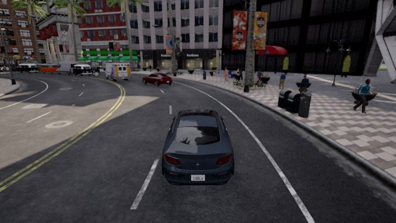
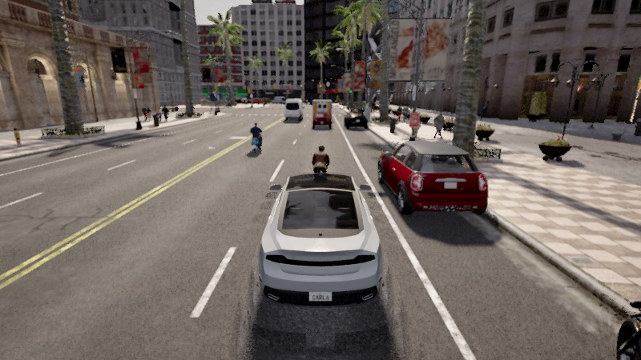

# Guided drive speed and resource repair — 18 October 2026

Guided preload now requests **80 km/h** for both arms. Both use the same native
route controller, with a 0.9 throttle ceiling and immediate native acceleration
instead of the experimental comfort integrator. Signals, destination slowing,
the protected RULE supervisor, command leases and sensor freshness limits still
apply. This is a requested stress speed, **not a guaranteed minimum**. None of
the retained native attempts demonstrates sustained 80 km/h or complete driving
acceptance.

## Changes

- The guided request reaches preload, WebSocket admission, journey admission
  and the native agent. Guided stress driving explicitly uses its requested
  speed instead of silently retaining a 30/50 km/h posted-road ceiling. The
  manifest records `GUIDED_STRESS_TARGET`; ordinary/research and legacy
  presentation speed limits remain unchanged.
- Guided arms no longer run the experimental longitudinal comfort integrator.
  Its previous reliance on applied brake/throttle repeatedly reset launch
  effort after protection holds. Its legacy/validation implementation is
  preserved. The native controller and final shield remain responsible for
  guided acceleration and braking; no velocity is injected or teleported.
- Health, connection and perception polling use an atomic, small status view.
  The inference worker no longer requests the complete comparison fixture and
  sensor history to learn a frame/session ID. The full state and replay APIs
  remain available. A sampling profile identified recursive comparison copies
  as a major background cost before this repair.
- Stable walker controller handles and route locations are reused. Snapshot
  disappearance checks and physical commands still run each native tick.
  Only the pedestrian activity *display label* is classified at four Hz.
- The HIGH preset retains Epic, D3D12, 1280×720 native rendering, 800×450 driving
  RGB, postprocessing, textures and temporal AA. Motion blur, screen-space
  reflections, refraction, light shafts and subsurface effects have tighter
  budgets. No population, required sensor, resolution or requested control rate
  was removed to obtain a better throughput number.
- Surface registration replaces masked-array median dispatch with a finite
  selected-sample reduction. Ragged-cloud differential tests compare both seed
  policies with the original `nanmedian` computation to 1e-12. Registration
  gates and protection thresholds are unchanged. A local 20-surface microprobe
  measured 18.79 → 17.56 ms per registration; this is not a full-drive speedup.
- Native step phase timings are exposed in diagnostics. The native verifier
  retains per-frame performance samples and now handles a natural ending that
  passes through FINALIZING before requesting the other arm.

## Native evidence

[Machine-readable summary](evidence/drive-speed-20261018/summary.json) retains
every attempted configuration, including failures and intermediate repairs.
Raw runs remain in ignored `runs/normal_city/`; the summary records their paths
and identities. These attempts use different seeds and durations and must not
be presented as a controlled performance comparison.

The final two-arm check used the delivered 0.9 throttle ceiling, unchanged
20 Hz requested simulation rate, **60 real vehicles and 100 real pedestrians**.
Its initial native density/motion audit passed, and both initial-condition
audits passed. Normal contacts remain recorded; the protected arm is explicitly
SHORTENED, not ARRIVED or a completed safe result.

| Final native arm | Outcome | Simulated duration | Distance | Peak speed | Time to 20 km/h, simulation time |
| --- | --- | ---: | ---: | ---: | ---: |
| Protected Mercedes | SHORTENED / guided_shortened | 19.05 s | 138.18 m | 46.24 km/h | 1.70 s |
| Normal Lincoln | COLLISION | 4.65 s | 42.32 m | 67.68 km/h | 1.80 s |

Both first exceeded 1 km/h within 0.75 simulation seconds of their first
recorded frame. The preceding clean check with the native route controller
and its 0.75 ceiling recorded Normal at 70.94 km/h before contact; Protected
covered 187.48 m, peaking at 47.39 km/h before explicit shortening. Those results
are retained separately and are not substituted for the delivered configuration.

The original operator recording had Protected effectively stationary, with
63 processing-deadline brake rows among 301 recorded decisions. The final
configuration recorded two such rows among 385 protected decisions. All
sensor and control age limits stayed intact. Remaining deadline brakes are
still real failures to meet timing, not evidence of obstacle detection.

Actual native throughput in the final drive had medians **6.89 Hz protected /
6.66 Hz normal**, below the requested 20 Hz. The intermediate slow configuration
had 4.94 / 4.06 Hz medians; seeds and code differ. Renderer FPS is unavailable
and is not inferred from tick cadence. The graphics are rendered normally, but
the dense scene and per-tick sensor analysis still fail the real-time throughput
goal. Protected braking often reports limited measured road coverage; it was
not disabled or relabeled to show a higher speed. Further throughput and driving
quality work remains necessary. The native tests do not establish sustained 80
km/h, a completed protected route, or collision-free behavior.

An idle HTTP probe on the final host measured the complete state response at
708,839 bytes / 81.46 ms median versus 229 bytes / 4.61 ms for the status endpoint.
These are five full-state and twenty status requests, on the same idle host.
This demonstrates the reduced polling cost, not a 17× driving speedup.

The profiled intermediate attempt ended with `observation_receipt_timeout`.
Its other arm did not run, and the old verifier stalled at FINALIZING; that
unfinished diagnostic invocation was stopped. A subsequent warm backend reload
timed out on native RPC. A full cleanup/restart of the identified project engine
recovered it, and both final native checks ran without a verifier error. These
failures remain in the evidence; sampling-profiler runs are not acceptance runs.
The final host has one CARLA engine, one backend and their owned inference
workers; launcher/child PIDs are not additional simulator instances.

Actual camera samples from the final native check:

## Verification and reproduction

- `npm run build:dashboard`: regenerated the checked-in JS and CSS successfully.
- `npm test`: **163 passed**.
- Python discovery: **638 discovered, 636 passed, 2 optional skips**.
- Added regressions cover guided native speed and posted-limit metadata,
  legacy speed limits, terminal slowing, shared native acceleration/signal
  brakes, lightweight status identity and equivalent registration reductions.
- Native execution: `python -m scripts.verify_preloaded_native --first
  ROBOSPHERE --hold-seconds 55 --output output/speed-profile-delivery`.
- Read-only evidence extraction: `python -m scripts.summarize_drive_speed`.
  It requires the retained local run files and a running native host. It never
  starts/retries a drive or modifies its outcomes.

The native service is running with the final code and tuned HIGH settings.
Refreshing the existing browser page prepares a fresh dense scenario on that
same engine; no extra browser page or simulator process is needed.
