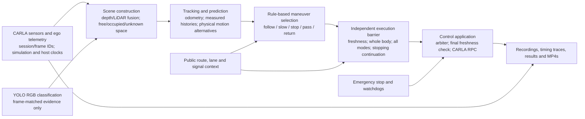

# Egypt V1 demonstration and academic defense — 27 October 2026

## Status and claim boundaries

**NOT ACCEPTED. This is a presentation/reproduction guide, not a native execution
authorization or completion certificate.** No new CARLA run or browser acceptance
was performed to write it. The [delivery index](evidence/egypt-urban-chaos-v1/delivery-index-20261027.json)
keeps source identities, measurements, failed attempts and local artifact paths.
The [freezing continuation](EGYPT_FREEZE_CONTINUATION_20261027.md) and
[fresh verification](evidence/egypt-urban-chaos-v1/freeze-continuation-verification-20261027.json)
record the updated-source offline checks and unresolved native prerequisites.
The [earlier delivery](EGYPT_DELIVERY_20261027.md) retains its historical source.
The [latest queue checkpoint](EGYPT_QUEUE_CONTINUATION_20261027.md) records
1045 Python passes with 4 optional skips on unchanged driving source and
separates completed event holds from later physical queues. It does not repair
or certify native route progress.
The [resource-accounting clarification](EGYPT_RESOURCE_ACCOUNTING_20261027.md)
adds two temporary-ledger regressions (1047 Python passes / 4 skips): one
minimum diagnostic reservation fits today's budget, three depend on actual
elapsed charges. The conservative 795-second request is not a proven required
increase; storage remains independently insufficient.
The [latest admission checkpoint](EGYPT_DIAGNOSTIC_STORAGE_20261027.md) applies
the existing storage gate to diagnostics too. It refreshes offline software
verification on the new gate fingerprint; no driving policy or native result
changes.

| Evidence class | What may be said |
| --- | --- |
| Historical measured | Dated reports certify only their recorded source and protocol. Attempts 18/19 are short failed DEVELOPMENT diagnostics, not accepted route runs. |
| Current source | Fingerprint `a0c2eb77...`: 210 JavaScript passes, 1,048 Python passes with 4 optional skips, dashboard build and 30/30 exact complete saved-decision payload comparisons passed. Diagnostic storage admission now refuses insufficient capacity. Offline software certificate only; controlled-age replay does not reproduce native asynchronous timing, and a gate-only source change is not a driving repair or retry authorization. |
| Experimental | Egypt maneuver driving remains restricted; learned research modes, the disabled path-entry predictor and shadow proposals have their own limits. |
| Future | VLM integration, new RL training, maps and PERFORMANCE_60 acceptance are not delivered Egypt results. |

The gate contract remains [EGYPT_COMPLETION_GATES_20261027.md](EGYPT_COMPLETION_GATES_20261027.md)
and [EGYPT_URBAN_CHAOS_V1.md](EGYPT_URBAN_CHAOS_V1.md), implemented by
`evaluate_pair`, `evaluate_matrix` and `publication_gates` in
`backend\core\egypt_urban.py`. A green UI state, unit tests, a playable video,
zero contacts in a prefix or worker exit 0 cannot unlock Egypt.

The [reproducible freezing benchmark](EGYPT_REPLAY_CONTINUATION_20261027.md#optimized-source-and-live-graph-measurements)
measured median 1.62555 to 1.33070 ms and p95 1.73133 to 1.426885 ms on one
actual captured pre-freeze graph, with 1,000 alternating samples per version.
This isolated approximately 0.295 ms median saving does not establish a native
latency reduction or fix Normal's stalls; full route/overtaking results remain
unexecuted on this source. Safety and timing thresholds are unchanged.

## Actual architecture



The diagram is a logical pipeline, not a claim that every stage runs serially:
bounded same-frame map/geometry prefetch can overlap sensor/tracking work.

| Stage / actual source | Responsibility | Boundary |
| --- | --- | --- |
| `backend\carla\sensors.py`, `backend\core\timing.py`, `backend\core\service.py` | Receive synchronized sensor channels, retain original timestamps and measured host arrival/encoding times. | CARLA truth is not a perception substitute. Missing/stale channels cannot authorize motion. |
| `ControlScene` / `MeasuredSpace` in `backend\core\control_scene.py` | Decode/fuse current depth and LiDAR, create immutable frame-bound scene and measured space with lazy bounded scope. | Unknown/occluded space stays unknown; a larger processing scope creates no measurements. |
| `backend\core\prediction.py`, `backend\core\kinematic_prediction.py`, `backend\core\depth_people.py` | Estimate odometry and measured tracks; associate camera semantics with geometry; propagate physical alternatives including braking, acceleration and pedestrian retreat. | Track loss does not prove the physical object disappeared; class confidence is not a free-space certificate. |
| `backend\core\urban_driver.py`, `backend\core\hybrid_driver.py` | Select legal useful maneuvers, maintain committed intent and observe body-cleared pass/return completion. | Egypt uses sensor scene, ego state and public road context, not scenario personas, hidden actor poses, event goals or overtake-count targets. |
| `ExecutionShield` in `backend\core\maneuver_candidates.py` | Independently veto using current freshness, complete-body measured/drivable swept space, all forecast modes and braking continuation. Full maneuver admission checks the entire intended corridor. | No learned dependency. Immutable same-frame proof geometry may be reused, but not previous-frame permission. A fallback brake does not guarantee avoidance of rear impact. |
| `backend\core\service.py`, `backend\carla\provider.py` | Arbitrate command ownership; recheck frame/session/wall/simulation freshness immediately before submission; send the native command and record its timing. | RPC return is not an exact physical application timestamp. Next-frame control-state observation is a separate check. |

**Independent** means a separate veto path and explicit proof conditions, not
an independently certified safety system or freedom from shared sensor/model
errors. Normal remains reactive sensor braking plus route/signals; the protected
driver adds prediction and maneuver ownership. Both preserve emergency stops.

### Timing vocabulary

- Pipeline latency: first required sensor receipt to application check,
  **p95 <= 200 ms, p99 <= 225 ms, zero frames >250 ms**; missing/unaligned
  frames also fail admission. Do not remove tail samples.
- Wall lease: **250 ms**; applicable simulation-age freshness: **100 ms**.
  The command's short lease and complete stopping continuation are different
  from the advisory forecast horizon.
- RPC duration, next-frame control-state verification, RTF, live/rendered FPS,
  simulation duration and wall-clock reservation cost are separate metrics.
  A 20/60 FPS MP4 uses its export clock, not a real-time throughput certificate.

## Environment and models

Use the [migration/setup guide](CARLA_0916_MIGRATION.md) for the official Windows
package and matching shipped wheel, not an arbitrary PyPI CARLA build.
The local inspection for this documentation found CPython **3.12.10**, CARLA
API **0.9.16**, NumPy **2.5.3**, Numba **0.68.0**, llvmlite **0.50.0**,
threadpoolctl **3.6.0**, websockets **15.0.1** and Pillow **12.3.0** in
`.venv-carla`; pinned dependencies are in `backend\requirements.txt`.
This is installed-environment inspection, not a new server version handshake.

Perception is isolated in `.venv-perception`: ultralytics **8.4.174**, ONNX
**1.19.1**, ONNX Runtime **1.23.2**, torch **2.14.1+cpu**, EasyOCR **1.7.2**.
`backend\requirements-perception.txt` and `scripts\setup_perception.ps1`
define setup. Only restore/install dependencies if missing; do not run setup
merely to demonstrate an already installed checkout.

```powershell
# Environment/model preparation only when required; downloads can be substantial:
.\scripts\setup_perception.ps1
```

That script calls `scripts.prepare_perception`, requires existing
`models\yolov8n.pt`, prepares the English recognizer and delegates ONNX export to
`scripts.prepare_lightweight_perception`. The latter downloads pinned official
YOLOv8s source weights when absent and verifies the source digest.

| Artifact | Relative path | SHA-256 |
| --- | --- | --- |
| Official YOLOv8s source (v8.3.0 asset) | `models\yolov8s.pt` | `1f47a78bf100391c2a140b7ac73a1caae18c32779be7d310658112f7ac9aa78a` |
| Locally exported 640 ONNX, also recorded in attempts 18/19 | `models\yolov8s-640.onnx` | `d7cf0bd1ec4dfe6afcab12444c888625d95c589e25c06c24b1283646175fa8e2` |

Historical diagnostic manifests identify `YOLOV8S_640_FRONT_AND_FOCUS_V3`.
Compare the runtime hash with the saved manifest when reproducing; an export
on another environment must not inherit the old hash without verification.
YOLO classifies; it does not choose driving commands. OCR is on-demand outside
guided driving. Optional DirectML and learned research artifacts are not
evidence that Egypt uses RL/VLM control.

Historical host: Ryzen 7 6800H, RTX 3060 Laptop **6144 MiB** VRAM, Windows-reported
**16 GiB** installed RAM (the older user-reported 32 GB discrepancy is retained).
Egypt requires Town10HD_Opt, LOW/D3D12, a connected 600–800 m route, the same
Mercedes coupe/sensor setup in both arms, <=60 km/h, and measured realization of
the requested 60 vehicles / 100 pedestrians. Requests are not achieved density.
Keep local installation/settings, virtual environments, weights and raw runs
out of Git. A clone alone does not include them.

## Safe startup and saved-evidence demonstration

Commands below were checked against actual launcher/parser source. They are
instructions, **not claims of execution in this documentation task**.
Run from the existing primary checkout, and stop the existing backend normally
before binding its HTTP/WebSocket ports with a different mode.

```powershell
# Read-only launcher/assets inspection; does not launch CARLA or open a browser:
.\Start-YA-RAB-OSTORHA.ps1 -Check
# Backend initially stopped; this is NOT offline isolation of the guided UI:
.\.venv-carla\Scripts\python.exe -m backend.server
```

The initially stopped backend can serve retained media, **but opening its
ordinary guided page may automatically request simulator startup/preparation**.
It is not a no-native browser-review mode. While native work is blocked, do not
open that guided page; use Replay below or direct MP4 playback instead.

For actual sensor replay, use this **instead of** the running backend:

```powershell
.\.venv-carla\Scripts\python.exe -m backend.server --replay runs\normal_city\run_c8d966cf0d16438180d3dd7e9e879bea
```

Open <http://127.0.0.1:8000/> only after choosing the appropriate mode.
This is historical attempt 19, not a successful full route. `--replay` reads the
retained real recording without connecting to CARLA; native controls are refused.
The retained gzip-backed sensor assets remain supported. Old raw files retired
by storage maintenance are not recoverable through replay merely because their
MP4s remain.

For a simulator-independent media presentation open
`runs\normal_city\run_c8d966cf0d16438180d3dd7e9e879bea\driving.mp4`
or `driving-annotated.mp4` in a player. Show the run ID, source hash, diagnostic
status and timing failure alongside it. Post-engine-exit hash/first-last-frame
decoding passed historically; this does not assert new browser playback.
Historical media outside the checkout may require the preserved evidence
archive at `D:\CodexArchives\native-evidence\ya_rab_ostorha`. The old C path is
a junction to that archive, not a disposable duplicate.

Read-only Egypt preflight (no `--run`, no allocation/reset/extension):

```powershell
.\.venv-carla\Scripts\python.exe -m scripts.native.validate_egypt_urban --egypt-budget output\egypt-validation --acceptance --report output\egypt-validation\defense-preflight.json
```

A preflight writes its requested report but starts no native work or reservation.
Do not overwrite historical report paths. Diagnostic/matrix execution belongs
to the authorized ordered gate procedure, not to this walkthrough.

## Native interaction walkthrough — pending verification, not executed here

Only after explicit native authorization, resource checks, exclusive process
ownership and budget prerequisites may the operator use:

```powershell
.\Start-YA-RAB-OSTORHA.ps1
```

The launcher can start/reuse the runtime and opening a fresh page can prepare the
world. Do not casually launch it as a read-only check. Never add a second
synchronous tick owner or borrow protected windows for presentation.

1. **Loading/status:** watch the primary status and expandable technical details.
   The current UI work labels **Ready / Preparing / Running / Saving /
   Verification Required**. These describe interaction/lifecycle state only.
   **Ready does not mean Egypt is accepted**, and GPU load/VRAM is advisory.
   Native verification of this updated UI remains pending final delivery.
2. **Scenario:** inspect Road scenario, independently of first-driver choice.
   Historical crossing (`SUDDEN_PEDESTRIAN_COMPARISON_V1`) retains its own
   protocol (up to 120 km/h); Egypt (`EGYPT_URBAN_CHAOS_V1`) is 600–800 m /
   <=60 km/h. Egypt selection/Refresh availability is inspection, not permission
   to prepare or start it. A validation block must remain visible.
3. **Driver/start:** choose Normal or Ya Rab Ostorha as first driver. Wait for
   native preparation and fresh sensors, then use the primary start action
   only when admitted. Automatic paired scenarios proceed under their native
   protocol; manually continued modes show an explicit next-driver action.
   The same initial manifest does not imply identical future traffic.
4. **Ordinary stop:** where manual continuation is offered, the primary
   next/end-drive action finalizes the current attempt; it is not an arrival.
   Automatic paired runs do not expose that same next action during motion.
   **Free GPU** is the ordinary save/shutdown action when offered. Preserve
   interrupted outcomes instead of calling them completed comparisons.
5. **Emergency:** use **Emergency stop** to latch braking, not as ordinary
   Finish. **Release emergency stop** acknowledges only when the session is
   fresh and controllable; do not treat release as an instruction to accelerate.
   Verify observed braking and the saved outcome in the authorized test.
6. **Results/Finish during export:** in Results select **Finish** while exports
   are still pending. Expect **Saving & closing…**; do not double-submit or
   assume the button click proves closure. Wait for export completion, SDK/world
   cleanup and verified CARLA exit. Preserve errors and incomplete exports.
7. **Reload during streaming:** refresh the same page. Confirm observation of
   the active attempt and stable comparison/run IDs; it must not silently
   restart an experiment. A different page may be observer-only and offer
   explicit **Prepare a fresh drive here**, which saves/stops the old attempt.
8. **After exit/history:** play retained trip/common-prefix videos to their
   real ends, refresh again and reopen historical comparisons in Results/Menu.
   Confirm the original scenario/version, pair ID, run IDs and driver identities,
   not a relabeled current Egypt result. Retain the dashboard backend if serving
   media; simulator exit is not backend exit. Direct MP4 playback needs neither.

Check all eight operations through actual native browser execution before
marking that gate passed. Intercepted browser fixtures and previous crossing
browser acceptance are not updated Egypt native-browser evidence.

## Historical comparison results and evidence

Distances below are reported travelled distance, not automatically route
progress. Exact route-completion percentages, missing metrics (`null`), source
fingerprints, pair/order identities and paths are in the delivery index.
No statistical complete-driver advantage is established by these failures.

| Historical scope | Seed / first driver | Actual recorded driver | Distance / simulation duration | Maximum speed | Contacts | Outcome |
| --- | --- | --- | --- | --- | --- | --- |
| Failed matrix attempt, 24 October | 1703 / Normal | Normal | 156.351 m / 181.900 s | 32.016 km/h | 0 | Stalled; no terminal arrival/contact, other arm absent |
| Same failed matrix | 1703 / protected | protected | 0.000221 m / 0.100 s | 0.007589 km/h | 0 | Sensor-scene timeout; other arm absent |
| Same failed matrix | 2707 / Normal | none | null | null | null | Route revalidation failed before recording |
| Same failed matrix | 2707 / protected | none | null | null | null | Route revalidation failed before recording |
| Same failed matrix | 3709 / Normal | Normal | 110.246 m / 167.700 s | 31.214 km/h | 0 | Stalled; no terminal arrival/contact, other arm absent |
| Same failed matrix | 3709 / protected | protected | 0.000200 m / 0.100 s | 0.006775 km/h | 0 | Sensor-scene timeout; other arm absent |

Those six attempted comparisons are **not twelve completed runs**. Preserve
their original failures, including incomplete exports. Normal's frame-level
audit found a leading Nissan Patrol about 9.068 m ahead, continuous measured
corridor 3.0 m and zero coverage speed cap; front depth gaps were about
4.379/4.401 m. A wider query did not prove the unknown body cells free. Traffic
density fell in the old runs and the seed-3709 merge expired; the persistent
queue cause is not proved. Do not force motion or fabricate a Normal collision.

| Protected seed 2707 diagnostic | Attempt 18 | Attempt 19 |
| --- | ---: | ---: |
| Distance / simulation duration | 64.567 m / 30 s | 63.946 m / 30 s |
| Mean / maximum speed (km/h) | 7.736 / 20.484 | 7.661 / 21.769 |
| Recorded route completion | 8.843% | 8.846% |
| Contact callbacks / completed overtakes | 0 / 0 | 0 / 0 |
| `FOLLOWING_LEAD` reason duration | 8.950 s | 9.100 s |
| Total stopped time | null | null |
| Sensor-to-application-check p95 / p99 | 199.005 / 224.172 ms | 215.750 / 234.514 ms |
| Maximum / frames >250 ms | 255.327 ms / 1 of 601 | 259.957 ms / 2 of 601 |
| CARLA call p95 / p99 | 0.101 / 0.119 ms | 0.105 / 0.167 ms |
| Recorded RTF | 0.223333 | 0.216708 |
| Native worker wall time, including lifecycle | 219.515 s | 218.234 s |
| Clean exit / cleanup / saved-video check | passed | passed |
| Diagnostic timing gate / route acceptance | failed / not accepted | failed / not accepted |

Following-reason time is **not total stopped time**. Worker wall time is not the
RTF denominator or complete ledger charge. Attempt 18's percentile pass did
not excuse its late frame; attempt 19 was worse. Neither run completed an
overtake/return or the full route. Earlier diagnostics 01–17, crashes, rejected
experiments and their separate fingerprints remain indexed, not concealed.

The [new bounded offline diagnosis](EGYPT_OFFLINE_DIAGNOSIS_20261027.md) reproduces
all 601 driving-frame timings and separately retains 32 held-prefix submissions:
attempt 19's **633-submission** p95/p99/max are **215.785 / 242.103 / 667.504 ms**.
The table above explicitly describes the original driving distribution, not
every submitted prefix command. Neither distribution passes the contract.
The diagnosis identifies collection, prediction and maneuver cost without
establishing a behavior-equivalent repair; runtime driving source was unchanged.
Its original 21-frame semantic replay matches the retained comparator; a fresh-clock
replay of late native frame 700 selects FOLLOW instead of native HOLD. This
explicit scheduling/deadline non-equivalence is not hidden as a successful native
recreation. Focused offline safety tests do not close Gate B or Normal progress.

### Remaining execution/resource gates

The latest historical snapshot left **645.013 s** diagnostic spendable,
**7200 s** protected DEVELOPMENT matrix, **480 s** browser, and **7200 s**
unused one-shot ACCEPTANCE. Historical D storage was **91.764 GiB free** versus
**130.431 GiB provisionally required**, including 50% margin and 4 GiB reserve.
Those are historical snapshots. The [completed read-only resource preflight](EGYPT_RESOURCE_PREFLIGHT_20261027.md)
provides a refreshed free-space snapshot, exact deficit and conditional diagnostic
reservation arithmetic; **storage and native prerequisites remain blocked**.
No storage relocation, maintenance, budget extension or native trial was performed.
Capacity must be recomputed from a complete
successful development matrix, not a 183.45 s prefix. C free space is not D
recording capacity. Do not delete the archive, reset ledgers or extend budgets.

Required order remains software/replay + resources, protected 2707 diagnostic,
Normal 1703 then 3709 diagnostics, complete DEVELOPMENT (1703/2707/3709,
both first-driver orders: 6 pairs/12 runs), frozen-source one-shot ACCEPTANCE
(961103/961109/961121, both orders: 6 pairs/12 runs), then protected native
browser verification. The current ordered Normal checks, full matrices and
final browser check are not executed. The older failed matrix remains historical.
Do not use holdout for tuning or splice diagnostics into a matrix.

## Likely academic defense questions

**What is the contribution?** A sensor-derived, frame-bound rule-based driving
and independent-veto pipeline with measurable maneuver completion, traceable
recordings and explicit admission gates. Egypt implementation exists, but its
required native acceptance is not achieved.

**Where is the AI? Is this RL or a VLM driver?** YOLO supplies learned visual
classification; physical tracking/prediction support rules. Egypt's implemented
driving policy is rule-based. Existing behavior-cloned/RL research and the shadow
proposal interface are separate; no VLM drives the car and no new training is
part of this delivery.

**How do sensors become a scene?** Same-session, frame-matched depth/LiDAR and
ego telemetry supply measured geometry and motion; camera semantics attach to
supported geometry. Unknown space is not inferred free. Missing models or
sensors produce explicit unavailable/hold states, not fabricated observations.

**Does prediction know what pedestrians will do?** No. It propagates bounded
physical alternatives from measured histories, including ingress/hesitation/
retreat. It is not ground-truth intent recognition or a universal predictor.

**Why two safety checks?** Maneuver admission checks the intended corridor;
the independent shield checks the proposed command/short lease plus full
stopping continuation, with another freshness check before the RPC. Shared
inputs and provisional physical response still limit the assurance.

**What counts as an overtake?** Measured ego progress beyond the full measured
lead body in the same travel direction and observed lane alignment, plus verified
return when required. A lane-change request or lost track is not completion.

**Is Normal intentionally weak?** No. It retains reactive sensor braking,
navigation and signals. Its actual safe arrival or genuine contact is recorded;
contact is not a required outcome and must never be manufactured.

**Can a result isolate the predictor's benefit?** Not here. Egypt compares
**two complete drivers**, changing prediction and maneuver ownership. Causal
subsystem attribution requires a controlled ablation, not an assumed explanation.

**Why is zero contact insufficient?** A stationary vehicle can avoid contact
without completing the route. Acceptance also requires route completion,
density/movement, event diversity, three completed passes/returns, healthy
measurement, timing, exports and cleanup.

**Why did Normal stop?** The retained evidence shows a real lead vehicle and
limited verified corridor, not an empty road. Density/merge problems also
occurred. Root cause and corrected native completion are still open.

**Is it real time?** No such acceptance is established. Attempt 19's RTF was
0.216708 and its timing gate failed. Export FPS does not measure live execution;
small RPC duration does not erase sensor/tracking/planning delay.

**How reproducible is it?** Source/config manifests, seed/order, initial
conditions, model hashes, all attempts and replay/media paths are retained.
Reactive futures and asynchronous perception timing can diverge; offline
semantic equivalence is not a recreation of native detector arrival timing.

**Does this represent Egypt or prove general safety?** No. Town10 test behaviors
are motivated by urban congestion, not a surveyed Egyptian map or empirically
calibrated national driving distribution. Few bounded simulator runs prove
neither universal safety, real-world transfer nor general superiority.

**What next?** Close measured latency and route-stop causes, solve verified
storage/time feasibility, verify final-source software/replay, then execute the
ordered authorized gates without weakening them. New VLM/RL/maps/PERFORMANCE_60
studies require separate authorization and evidence. Preserve the existing
[shadow research package](BEHAVIOR_PROPOSALS_20261027.md) and its negative/null results.
