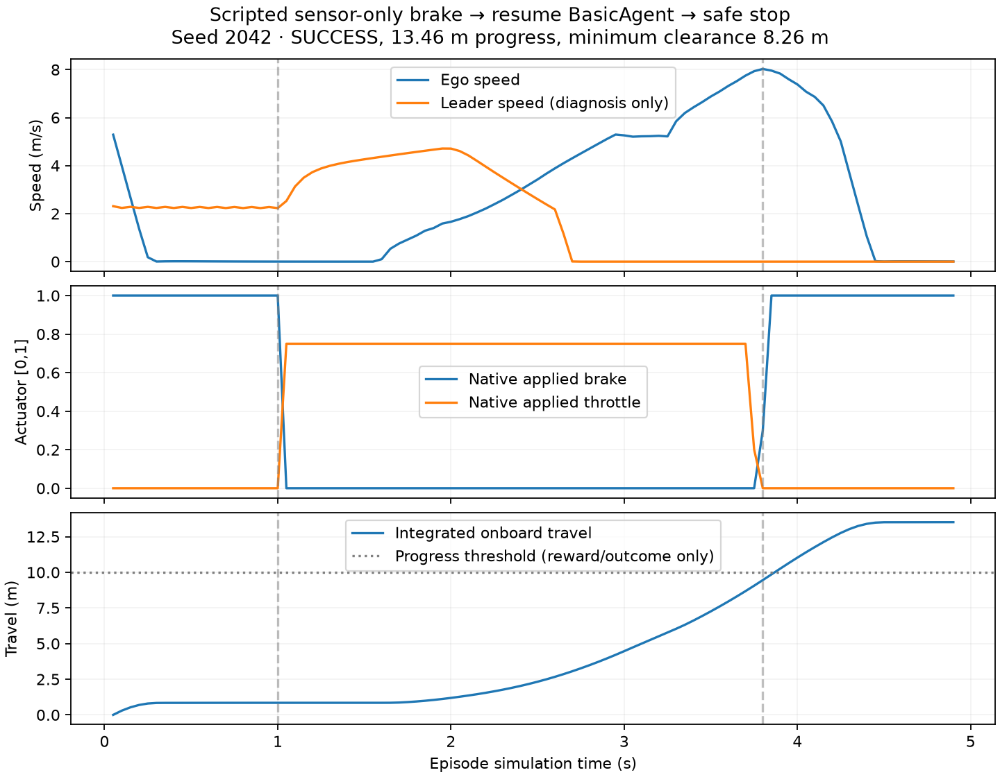
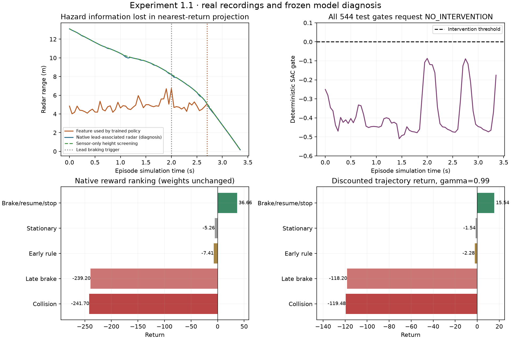

# Experiment 1.1 — failure diagnosis, no training

The Sudden Braking task is solvable with the current permitted braking-only
supervisor. A deterministic sensor-only brake–resume–stop controller achieved
SUCCESS on three native CARLA seeds. The saved SAC failed because its
deterministic gate was negative on every held-out step, suppressing otherwise
nonzero brake outputs before feasibility admission. The strongest verified
observation defect is loss of early lead-vehicle returns during feature
selection. Sparse terminal experience and the discontinuous action mapping are
additional verified design limitations; their individual contribution to the
learned weights cannot be established by this diagnosis alone.

No training, model changes, reward tuning, success-condition edits, scenario
expansion or production safety changes occurred. The existing model, replay
buffer and experiment logs remain intact.

## 1. Is the scenario solvable under current constraints?

Yes, for its actual task: **safe approach-and-stop behind the leader**.

The exact checks in `backend/rl/reward.py::episode_outcome` are:

- No collision episode; any callback meeting the configured impulse threshold
  terminates COLLISION first. Experiment 1's threshold is zero.
- Remain inside the supported corridor: lateral displacement within
  `lane_width/2 - 0.5 m` and heading deviation below 30 degrees. Leaving it
  terminates ABORTED before the success check.
- Signed progress from the episode's initial native ego position at least 10 m.
- Current planar vehicle-footprint clearance at least 2 m.
- Ego speed below 0.2 m/s and leader speed below 0.3 m/s together for at least
  0.5 simulation seconds.
- Episode duration at least the configured 2 s braking trigger.
- Otherwise time limit 12 s / 240 steps produces TIMEOUT, a truncation.

The leader receives throttle 0.35 until the 2 s trigger, then brake 1.0 for the
remainder of the episode. `before_tick` keeps the last schedule segment active;
there is **no resume segment**. Native non-collision recordings confirm it
stops around 2.7 s and remains stopped through the 12 s stationary test. The
leader's small motion after impact in collision recordings is physical contact,
not a scheduled driving resume.

The ego can release its supervisor and advance again after an initial stop,
then stop safely behind the leader. Continuing past it is a different task:
the leader still blocks the route, there is no resume, and this supervisor
cannot certify lateral free space. CARLA vehicles physically have steering and
BasicAgent's steering remains applied, but an RL steering *adjustment* is
rejected. Side evidence is always false for this profile. Acceleration above
the base command, reverse, gear changes and passing outside the supported lane
are unavailable. None is needed for the demonstrated completion.

## 2. Did a scripted safe-progress trajectory succeed?

Yes, **3/3 tests**: TEST seeds 2042, 2043 and VALIDATION seed 1042. Each completed
in 98 action steps / 4.9 simulation seconds with zero collisions.

| Seed | Outcome | Progress (m) | Minimum clearance (m) | Minimum native TTC (s) | Return |
|---|---|---:|---:|---:|---:|
| 2042 | SUCCESS | 13.4594 | 8.2558 | 1.3975 | 36.6558 |
| 2043 | SUCCESS | 13.4771 | 8.1354 | 1.3801 | 36.6306 |
| 1042 | SUCCESS | 13.4686 | 8.1384 | 1.3816 | 36.6633 |

The diagnostic controller brakes initially, releases to BasicAgent at 1 s
after ego speed falls below 0.2 m/s and measured space allows continuation,
then brakes again when the measured stopping envelope is reached. Forward
travel is integrated from onboard speed. Its inputs are only the existing
radar/ego arrays and synchronized sensor time. It uses the audited 0.65 m radar
mount and a limited flat-road screen `0.65 + range*sin(altitude) > 0.25 m` to
exclude low returns. It has no actor transforms, identities, route, future
schedule or reward context. This screen is a diagnostic heuristic on these
straight roads, not a general road-surface or free-space estimator.

For seed 2042, the sequence was initial braking at step 0, release at step 20,
then final braking at step 76 after observing range 11.84 m against a 12.25 m
sensor-derived stopping threshold. It advanced another 12.66 m after the first
stop. All 42 accepted braking steps went through `decide_intervention`, the
existing feasibility protocol/admission, safety layer and command arbitrator.
NO_INTERVENTION returned the base command. Native applied controls matched.

The complete bounded plan also reproduced no-intervention collision, late
braking collision and permanent-braking timeout. It was registered before
execution, contained six episodes, allowed at most 1440 action steps / 900 wall
seconds, and actually used **670 steps / 68.75 wall seconds**. There was no
adaptive controller search or additional native test run.

## 3. Why did trained SAC never intervene?

Every TEST deterministic gate was negative: 544 decisions, mean -0.379993,
median -0.430413, standard deviation 0.116011, range
[-0.509812, -0.086119]. VALIDATION's 272 decisions were also all negative.
The TEST brake head was nonzero, range [0.361354, 0.504370], mean 0.422948.

| Path stage | Measured result |
|---|---|
| Actor Gaussian mean | Unsquashed gate mean -0.405785 across TEST observations |
| Tanh squashing and Box unscaling | Gate sign unchanged; brake mapped correctly into [0,1] |
| Hard gate `<= 0` | 544 NO_INTERVENTION decisions |
| Positive proposals | 0 |
| Feasibility accepted / rejected | 0 / 0; validator was never reached |
| Arbitration | TRAINING/base command selected on every TEST step |
| Applied native control | Matched base command within the unchanged 1e-5 tolerance |

This is a policy-output/decoder outcome, **not validator rejection or lost
accepted braking**. Steering rejection also did not cause these held-out
decisions: the gate returned before that axis was inspected.

Recorded observations were rebuilt through the exact existing sensor boundary,
four-frame assembler and 47-feature projection. Re-running the frozen model
reproduced saved actions with maximum error **1.19e-7**. The raw Gaussian mean,
tanh result, unscaled output, decoding, arbitrated command and telemetry for
initial and collision frames are retained in [gate-analysis.json](evidence/experiment1-1/gate-analysis.json).
For the first seed-2042 decision the environment output was approximately
[-0.250538, 0.504323, 0.047751]; actual controls were the base proposal
[0.013046 steering, 0.75 throttle, 0 brake].

The exact cause of the optimizer moving the mean negative cannot be isolated
without a separately authorized controlled experiment. The frozen critic has
a preference toward negative gates in a fixed-brake/zero-steering slice:
mean minimum Q 1.3755 at gate -0.9 versus 1.2912 at +0.9. Its mean derivative
with respect to gate at deterministic policy actions is -0.02209, though some
states have positive derivatives. These are learned function measurements,
not calibrated safety probabilities or proof of a unique causal mechanism.

## 4. Are rewards correctly ordered?

**They prefer actual safe progress over permanent stopping and collision in
these measured trajectories**, including with SAC's gamma=0.99 discount.

| Case, seed 2042 | Outcome | Raw trajectory return | Discounted return |
|---|---|---:|---:|
| A. No intervention | COLLISION | -241.6960 | -119.4765 |
| B. Existing early rule braking | TIMEOUT, no collision | -7.4051 | -2.2820 |
| C. Brake starting at 3.25 s | COLLISION | -239.1971 | -118.2034 |
| D. Brake, resume, safe stop | SUCCESS | 36.6558 | 15.5400 |
| E. Full braking throughout | TIMEOUT, no collision | -5.2576 | -1.5446 |

B comes from the unchanged original Experiment 1 recording; A/C/D/E are new
matched native resets with identical scenario specifications and measured
settled positions. Reused-world physics across the two sessions is not claimed
bitwise identical. Original exploration SUCCESS (seed 43) scored +27.0181,
discounted +10.4931. The untrained reference's original oscillating timeout
averaged +10.0407 despite no completion, below demonstrated safe completion
but above permanent stopping.

| Weighted component | A: collision | C: late brake | D: safe progress | E: stationary |
|---|---:|---:|---:|---:|
| Collision | -100.0000 | -100.0000 | 0 | 0 |
| Severity | -155.8209 | -153.2007 | 0 | 0 |
| Proximity | -0.7111 | -0.7107 | 0 | 0 |
| Safe forward progress | 15.7898 | 15.7898 | 13.4594 | 0.7975 |
| Delay | -0.6800 | -0.6800 | -1.3600 | -4.7600 |
| Final-control smoothness | -0.2739 | -0.3955 | -0.3485 | -0.1000 |
| Unnecessary braking | 0 | 0 | -0.0950 | -1.1950 |
| Success | 0 | 0 | 25.0000 | 0 |

Late braking reduced peak impulse from 15582.09 to 15320.07 N·s and modestly
improved reward, but still failed. The collision trajectory's rewarded progress
is its earlier progress while the safety checks passed; its final unsafe motion
is not rewarded. Component sums were checked against durable episode totals.

The ranking does not eliminate these credit/design problems:

- Success +25 and collision/severity arrive only at terminal events. The
  1255-transition training buffer contains **one success reward sample and one
  collision reward sample**. Success occurred during random warmup at step 371;
  the only collision was at step 1207. There were 48 further updates after it
  (49 including the update at its own step), before infrastructure stopped.
- Uniform 64-sample replay gives approximately 2.55 expected draws of that
  collision sample across the remaining updates. This is an analytical
  expectation from the library sampler, **not an observed sampling count**.
- Smoothness scores final commands, including BasicAgent throttle/brake/steer
  behavior outside the supervisor's control. The successful random trajectory
  lost 6.1394 to smoothness despite reaching the task goal.
- Braking toggles can create immediate pedal-change costs. There is no distinct
  causal intervention credit or direct penalty for raw steering proposals that
  cannot affect physics.
- The "unnecessary" heuristic uses current gap/TTC, not future need. It labels
  19 initial braking steps unnecessary in the successful diagnostic sequence.
  That initial stop was deliberately diagnostic; this count does not prove
  all preemptive braking was physically necessary or incorrectly penalized.
- Positive progress can score above zero on a timeout without completion.
  TIMEOUT has no separate terminal failure penalty. The original early rule
  scores below constant braking because its final-control variation differs.
- The buffer correctly distinguishes truncation from termination: TIMEOUT
  samples bootstrap, SUCCESS/COLLISION samples do not. Whether this is the
  intended finite-horizon task objective remains a design question, not a
  misreported Gymnasium flag.
- The actor lacks an explicit onboard odometer, elapsed task time or persistent
  memory beyond 0.15 s. The progress/stop-duration goal depends on longer
  history. This is a partial-observability limitation, not demonstrated to be
  the sole reason the gate learned negative outputs.

No weights were adjusted. Full components and trajectories are in
[reward-analysis.json](evidence/experiment1-1/reward-analysis.json).

## 5. Are observations timely and informative?

Native capture is timely; **the deployed experiment projection discards useful
early information**.

Across all 544 pre-action TEST observations, the radar has lead-bounding-box
associated returns in both the full sensor packet and retained nearest 32
points. Ground truth is used only for this offline association. The feature
builder then picks one nearest point in its forward cone and drops altitude:

- 432/544 selected points have world height within 0.12 m of the road and do
  not fall in the leader's box.
- 112/544 selected points associate with the leader's box (0.15 m tolerance).
- On every seed the first selected leader point occurs at 2.7 s, leaving
  0.7 s before impact at 3.4 s. Ego speed is about 7.94 m/s and selected range
  about 5.0–5.07 m at that point. This is a reduced response margin; it is not
  proof that every possible brake at 2.7 s would fail.
- The selected initial point has range 4.8423 m, altitude -0.127798 rad,
  closing radial velocity -7.1348 m/s and world height **0.00020 m**. The raw
  leader returns begin around 13.1047 m with velocity -3.52 m/s.
- The initial selected range/closing proxy is approximately 0.679 s, dominated
  by the road moving relative to ego. It is not a verified object TTC.
- The simple diagnostic height screen selects a leader-associated return on
  **544/544** of these recordings, with no ground-associated selections. This
  result is limited to the sampled straight-lane conditions.

Speed, IMU acceleration, yaw rate and radial motion are present. They do not
identify which obstacle generated the compressed nearest return. Four history
frames cover only 0.15 s at 20 Hz. All 544 observations were complete, had exact
sensor frame/time agreement, and had no history gaps above the configured
timestep. Missing data, stale frames, OCR, YOLO or CPU image inference do not
explain this failure.

Geometric association is an offline diagnostic, not a semantic sensor label.
The reconstruction used actual radar transforms and checked its rotation
matrix against CARLA's native Transform API (maximum error 5.98e-8). No actor
identity, transform or bounding box was supplied to policy inference or the
scripted native controller. Removing ground truth and actor arrays from real
initial/pre-impact frames left policy features identical.

CARLA 0.9.16 computes radial velocity from target minus sensor velocity along
the outgoing ray; negative closing velocities here use the correct sign.
Static road returns can therefore appear strongly closing.
[Official radar source](https://github.com/carla-simulator/carla/blob/0.9.16/Unreal/CarlaUE4/Plugins/Carla/Source/Carla/Sensor/Radar.cpp).

## 6. Is the intervention gate blocking learning?

It blocks the saved deterministic actor's brake head from execution. It
**does not completely block exploration or learning**.

| Training phase | Positive gate proposals | Braking accepted | Whole proposal rejected |
|---|---:|---:|---:|
| Random warmup, steps 1–500 | 239/500 | 239 | 0 |
| Stochastic SAC, steps 501–1000 | 233/500 | 233 | 0 |
| Stochastic SAC, steps 1001–1255 | 84/255 | 84 | 0 |
| Total | 556/1255 | 556 | 0 |

Steering axes were rejected on 553 positive-gate steps; independently admissible
braking remained accepted. The entire useful warmup success trajectory and its
terminal reward were present in replay. Saved scaled actions match traces
exactly; replay reward discrepancies are only float32 rounding (maximum
4.89e-6). Useful intervention learning signals were delivered, but sparse.

The final Gaussian still assigns a mean **30.10%** chance to a positive gate
on TEST observations (range 22.50–45.85%). These are probabilities computed
from the frozen Gaussian, not new stochastic CARLA trials. Deterministic
evaluation takes the squashed mean and yields zero proposals. The two
evaluation/training behaviors differ materially.

Mapping weaknesses are structural:

- All gate values in [-1,0] cause identical physical commands. Brake and steering
  have no effect there. Near zero, positive brake causes a discontinuous change.
- Steering is ineffective even in the positive half-space because side-space
  verification is unavailable, yet SAC includes it in its three-dimensional
  entropy target (-3).
- The learned critic varies with negative gate magnitude despite identical
  physical decoding, demonstrating approximation artifacts in that region.
- SAC updates the actor through the learned Q function, not through CARLA or
  this decoder. A hard gate therefore does not create a literal zero-gradient
  barrier through an environment autograd graph. Fitting this discontinuity
  with little data is a plausible difficulty, not proof that SAC cannot learn.
  [Official SB3 2.9.0 implementation](https://github.com/DLR-RM/stable-baselines3/blob/v2.9.0/stable_baselines3/sac/sac.py).

## 7. Proven findings versus causal hypotheses

| Finding | Status |
|---|---|
| Task can be completed by permitted braking/release | Proven by 3 native SUCCESS episodes |
| Deterministic gates suppress all trained-policy test braking | Proven by 544 replayed predictions and native control traces |
| Validator/arbitrator rejected trained-policy interventions | Disproved: none were proposed; accepted scripted/training brakes reached physics |
| Relevant radar data was present early and removed by feature selection | Proven by raw/nearest32/selected return comparison and geometry diagnosis |
| Recorded whole-trajectory rewards favor safe completion | Proven for tested trajectories; no global reward-optimality claim |
| Training had few terminal events and stopped shortly after its first collision | Proven from replay, logs and update counts |
| Hard gate/redundant steering and critic approximation contributed to mean drift | Plausible, consistent with critic measurements; causal share unproven |
| Limited state history and final-control reward costs made credit assignment harder | Structural limitations; effect size unproven |
| Fixing one defect will yield a successful learned policy | Not established; no retraining was performed |

## 8. Evidence, tests and preservation

Starting HEAD: `13f3b370b7f30e95cc868f4c5132b556bacc578f`. Work is on
`codex/experiment1-1-failure-diagnosis`. All original commits, models and logs
were retained. Existing uncommitted README/population/urban/docs/verifier/test
changes and the untracked Gate 5 verifier remain untouched. A binary recovery
patch and verifier copy are under `output/experiment1-1-preserved`; comparison
confirmed the original tracked patch remained byte-for-byte unchanged.

Only three diagnostic scripts, this report and diagnostic evidence were added.
Runtime, observation production, action mapping, validator, reward and model
files were not edited. Model SHA-256 remains
`9b3bceb0c77aaea8a6cad71600d36f90b1dfbf2277ffad94ea6b91f42f5ac679`.

Native audit passed:

- Six episodes / 670 verified actions / 676 complete recorded frames.
- Exactly one native frame advanced per action; simulation-worker ownership.
- Expected and applied controls matched; source SAFETY on accepted intervention
  and TRAINING on release/no intervention.
- Every reset had two vehicles, seven sensors, no walkers/controllers; cleanup
  verified. Every close restored one normal ego vehicle and seven sensors.
- 2028 unique binary asset references; 36 sampled checksums checked through
  ReplayReader. No stale/adjacent observation was substituted.
- Matched new seed-2042 settled position deviation was 0.0 m; scenario specs
  identical. No claim of bit-for-bit deterministic physics across sessions.
- Native ground-truth removal invariance on three actual frames; existing
  privileged-field rejection and contract tests passed.
- 157 Python tests ran: 156 passed, one inapplicable API-absence test skipped.
  All 24 JavaScript tests passed. No normal-driving implementation changed.
- Live backend connected, PAUSED, RL lease released, no learned production
  policy active. No further training or native scenario tests were launched.

Durable details:

- [Native verification](evidence/experiment1-1/native-verification.json)
- [Gate trace and distribution](evidence/experiment1-1/gate-analysis.json)
- [Replay and learning signals](evidence/experiment1-1/learning-signal-analysis.json)
- [Reward components and recording references](evidence/experiment1-1/reward-analysis.json)
- [Observation summary](evidence/experiment1-1/observation-analysis.json) and
  [per-frame timing](evidence/experiment1-1/observation-timing.jsonl)

Native recordings and scripted traces are referenced from
`runs/diagnostics/experiment1_1_20261008T190202Z`. The scripts are diagnosis-only;
the native script itself performs additional bounded experiments when invoked,
so it should be run only when those tests are authorized. The other scripts
read existing records and generate evidence without learning or physics ticks.

## 9. Single smallest justified change for Experiment 2

**Change only the lightweight forward-radar feature selector to exclude
ground-height returns before choosing foreground range and radial velocity.**
Keep observation dimension 47, sensor sources, reward, architecture, gate and
feasibility rules unchanged for that isolated comparison. Preserve a validity
indicator when screening leaves no trustworthy foreground return. The tested
height screen is a starting hypothesis for these lanes, with explicit pitch/
slope limitations; it is not a general production detector.

This is smaller than changing the network, reward or success goal. It directly
addresses the strongest verified information-loss defect: lead returns existed
in the already-retained 32 points on every test frame, while the actor mostly
received road returns. The diagnostic controller's success demonstrates that
useful progress is possible with this permitted sensor evidence and existing
actuator/admission path. It does not prove that SAC will learn after screening.

This change is a recommendation only. It has **not** been applied to the
environment or existing model. Experiment 1.1 stops here; Experiment 2 requires
separate authorization. These eight TEST seeds have now informed diagnosis and
the proposed feature change; a future experiment needs a fresh untouched test
set for an unbiased claim of improvement.
