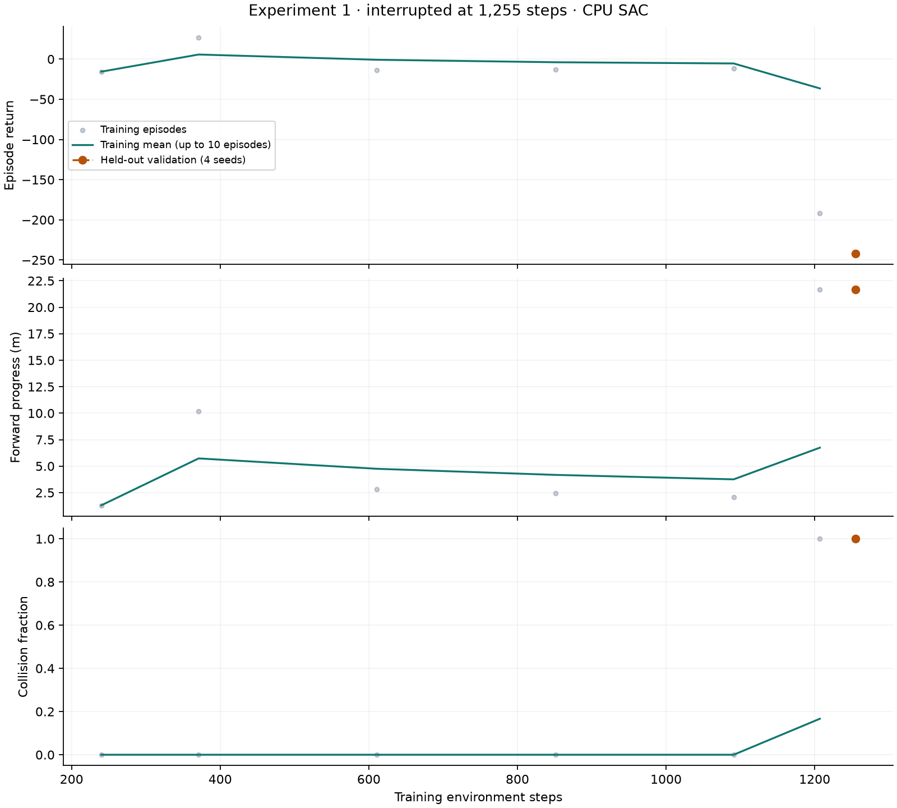
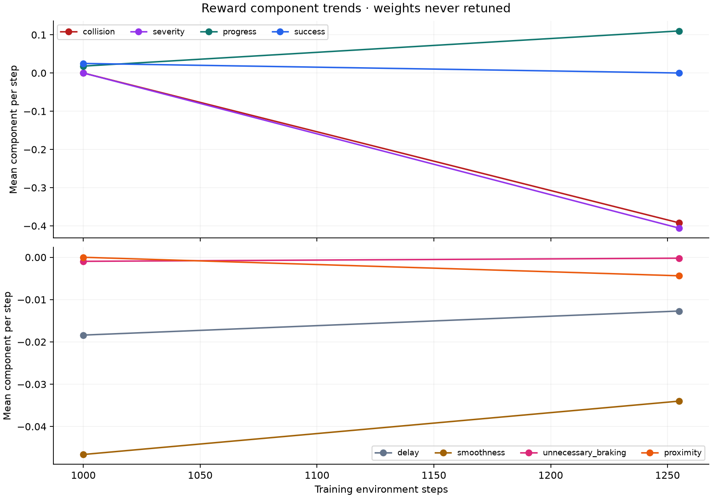
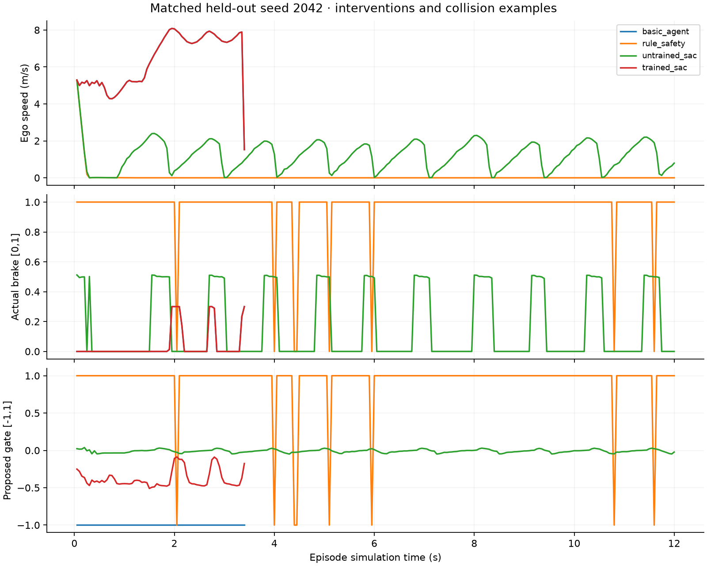

# Experiment 1 — negative safety-learning result

One real CARLA SAC experiment ran and stopped early on a native control
verification failure. The saved policy **did not demonstrate beneficial safety
learning**: it intervened on zero held-out test steps and collided on every test
seed. No additional training, production activation or scenario expansion occurred.

The registered design is in [EXPERIMENT1_PROTOCOL.md](EXPERIMENT1_PROTOCOL.md).
Machine-readable measurements are in [experiment1-summary.json](evidence/experiment1-summary.json).

## 1. Algorithm and architecture

Stable-Baselines3 2.9.0 SAC, PyTorch 2.14.1+cpu, two CPU threads, model seed 12345.
The Gaussian actor has two 64-unit ReLU layers with squashed mean/log-std heads;
twin Q critics each have two 64-unit ReLU layers. The actor has 7,622 parameters.
There were 755 gradient updates. Actor parameters changed by L2 norm 1.404634,
which proves optimization occurred, not that safety improved.

SAC was selected because intervention pressure is continuous and the established
library supports this bounded Box interface on CPU. The gate is discontinuous
and the unsupported steering dimension is redundant; this is a feasibility
baseline, not evidence that this action parameterization or algorithm is optimal.

## 2. Observation and action dimensions

47 float32 inputs: four frames of eleven onboard/radar features, then the current
base-driver steering/throttle/brake proposal. No images, YOLO, OCR, absolute
timestamps, world poses, actors, future trajectories, routes or reward-only
ground truth enter the actor or critic observations. Information in diagnostic
`info` is explicitly excluded from the feature builder.

Three continuous outputs: gate [-1,1], extra brake [0,1], steering proposal
[-1,1] scaled by 0.15. Gate <=0 preserves the base command. Accepted intervention
can only increase braking and suppress throttle. Unverified steering changes
are rejected; this radar profile supplies no side-space certification.

BasicAgent remains the driver, with its vehicle/light/stop-sign hazard handling
disabled for these labeled comparisons. Its map and route stay on the native
worker. The training-only validator implements the existing feasibility protocol,
followed by existing admission, safety layer and arbitration. It checks current
sensor validity and actuator constraints; it is not a complete production
maneuver validator. Final controls are checked against native telemetry.

## 3. Actual training duration and steps

117.062 wall seconds; 1,255 valid returned training transitions. A further
native physics step advanced but failed applied-control verification, making
**1,256 confirmed action-advancing physics steps** (reset stabilization excluded).
That invalid transition never entered
the learner. Limits were 10,000 steps and 3,600 seconds. Neither was exceeded.

Seven TRAIN seeds were actually visited (42–48). Six episodes completed:
four TIMEOUT, one SUCCESS, one COLLISION; the seventh ended SIMULATOR_FAILURE.
The success was an exploration episode and did not establish learned-policy
performance. Checkpoints planned at 2500/5000/7500/10000 were not reached.
The saved early-stop checkpoint was evaluated on four VALIDATION seeds and
eight TEST seeds. Training was never resumed after the repair.

## 4. Learning curves

There are only six completed training episodes. The validation point is the
frozen early-stop model, evaluated after training stopped; it is not an
intermediate checkpoint selected to improve the reported score. Validation
collision rate was 4/4, success 0/4, mean return -241.7563.

## 5. Reward components and trivial behavior

Weights and reward formula remain unchanged from Gate 6. Components are logged
per native step. The first chunk contains 1,000 steps and the second 255; these
are two coarse samples, not a dense trend estimate.

| Mean weighted component per step | Steps 1–1000 | Steps 1001–1255 |
|---|---:|---:|
| Collision | 0 | -0.39216 |
| Severity | 0 | -0.40602 |
| Safe progress | 0.01802 | 0.11006 |
| Delay | -0.01839 | -0.01271 |
| Smoothness | -0.04661 | -0.03400 |
| Unnecessary braking | -0.00096 | -0.00022 |
| Success | 0.02500 | 0 |

Before learning, always braking produced TIMEOUT with 0.7972 m progress. A
constant steering proposal without side-space evidence was rejected and the
base driver collided. The rule baseline subsequently intervened on 96.67% of
test steps and remained nearly stationary. The untrained model oscillated
between braking and the base command; it obtained positive returns without
meeting the stop-and-completion criterion. These are documented reward/design
risks. No weights were altered to hide them.

The trained model exhibited a different trivial failure: no safety intervention.
All test gates were negative, ranging from -0.5098 to -0.0861. Its higher progress
ended in impact and is not useful safe progress. Smoothness measures final
controls, including BasicAgent speed regulation, which complicates supervisory
credit assignment. Impulse is a severity proxy, not an injury measurement.

## 6. Saved model and provenance

Run directory: `runs/experiments/experiment1_20261008T165154Z`.

- Saved weights: `final_model.zip` (the interrupted model, not a successful policy).
- Untrained reference: `initial_model.zip`.
- Replay buffer: `replay_buffer.pkl`.
- Configuration, seed manifests, versions, source hashes/snapshots, SB3 CSV,
  per-step traces, component logs and native episode references are retained.
- Final model SHA-256:
  `9b3bceb0c77aaea8a6cad71600d36f90b1dfbf2277ffad94ea6b91f42f5ac679`.

The one-shot marker at `runs/experiments/experiment1-training-started.json`
prevents accidental reruns. Final weights remained unchanged during evaluation.

## 7. Matched baseline comparison

All values below are actual eight-seed TEST measurements with the same initial
scenario specifications. Completion means verified safe approach-and-stop.
Progress in a collision episode is not evidence of successful avoidance.

| Controller | Collisions | Completion | Mean peak impulse (N·s) | Mean progress (m) | Mean minimum clearance (m) |
|---|---:|---:|---:|---:|---:|
| BasicAgent alone | 8/8 | 0/8 | 15576.75 | 21.6948 | 0 |
| BasicAgent + rule safety | 0/8 | 0/8 | 0 | 0.7975 | 12.7638 |
| BasicAgent + untrained SAC reference | 0/8 | 0/8 | 0 | 14.7419 | 6.8875 |
| BasicAgent + trained SAC | 8/8 | 0/8 | 15576.75 | 21.6948 | 0 |

| Controller | Mean unnecessary intervention steps | Mean speed (m/s) | Hard-deceleration events/s | Mean client safety-decision overhead (ms) | Mean native HTTP step (ms) |
|---|---:|---:|---:|---:|---:|
| BasicAgent alone | 0 | 6.3809 | 1.4706 | 0.0068 | 82.3153 |
| Rule safety | 231.000 | 0.06665 | 0.08333 | 0.0435 | 84.0352 |
| Untrained SAC reference | 45.375 | 1.2295 | 0.8750 | 0.6699 | 84.6107 |
| Trained SAC | 0 | 6.3809 | 1.4706 | 0.6446 | 80.7773 |

Unnecessary counts are accepted changed-control *steps*, not episode counts.
Hard braking uses native longitudinal acceleration <=-4 m/s² and can include
initialization transients and the base driver's speed PID. Existing BasicAgent
speed-regulation braking is not YA RAB OSTORHA intervention. The raw traces
separate proposal, admission, command source and native applied control.

The small BasicAgent client figure measures constructing NO_INTERVENTION;
BasicAgent planning runs on the service worker and is included in native step
time. Mean decision-plus-step wall time was 82.322 ms for BasicAgent alone,
84.079 ms for the rule baseline, 85.281 ms for the untrained reference and
81.422 ms for trained SAC. These are synchronous experiment latencies, not
measured real-world emergency reaction times.

## 8. Held-out evaluation and reproducibility

VALIDATION: 1042–1045. TEST: 2042–2049. All weights were frozen before TEST;
no test score selected or tuned the model. Eight seeds cover seven distinct
test spawns; one spawn also appeared in training. Held-out seeds therefore
do not imply entirely unseen geometry or generalization beyond this task.

Across matched controller resets, measured maximum settled position and velocity
deviation was 0.0 m / 0.0 m/s. Absolute timestamps and binary physics/sensors are
not claimed deterministic. The collision-rate Wilson 95% interval for 8/8 is
approximately [0.676,1]; for 0/8 it is [0,0.324]. The sample cannot establish
population reliability, and the saved model failed even this small sample.

## 9. Collision and intervention examples

Held-out seed 2042 shows BasicAgent and trained SAC following overlapping control
and speed traces into collision; the learned gate remains negative. The rule
baseline brakes almost continuously. The untrained model repeatedly accelerates
and brakes, making progress but failing completion. Exact recording directories
and trace files for these examples are in the durable summary.

A diagnostic initial radar return had depth 4.8423 m, altitude -0.12780 rad,
radial velocity -7.1348 m/s and a mount-plus-return height around 0.03284 m.
This is consistent with a ground return, not a verified lead-vehicle detection.
The nearest-return projection and naive rule can be dominated by such low
returns. This observation-quality limitation requires investigation before
another learning experiment; privileged actor geometry was never substituted.

## 10. Native, performance and memory evidence

Native adapter tests passed exclusive ownership, one frame per step, valid
sensor-only vectors, no-intervention removal of old safety control, accepted/
actual control matching, stale-command rejection, actor cleanup and restoration.
Every experimental reset retained two vehicles, seven sensors and zero walkers/
controllers. The policy observation tests reject privileged fields and prove
ground-truth changes and absolute timestamps cannot change projected features.

The recording audit checked 36 validation/test episodes, **5,236 complete frames**,
exact native sensor timestamps and 15,708 unique binary asset files (three per
frame). It verified sample asset checksums through ReplayReader. No invalid or
adjacent frame was substituted, and no duplicate sensor binaries were recorded.

Training step latency: median 78.20 ms, p95 105.18 ms, maximum 203.17 ms.
Training-process private memory samples: 772.66–773.27 MiB; actual backend
worker 566.41 MiB at both sampled training points; CARLA 9710.10–9720.23 MiB.
Samples at 500/1000 steps are too sparse for an endurance claim. The final
training snapshot had backend 578.24 MiB. Buffer maxima were history 4,
assets 256, camera/frame caches 32 each and pending synchronized frames 0.

A post-training GPU snapshot was 5797/6144 MiB. SAC used CPU throughout and
introduced no GPU model allocation. Sensor capture and existing display work
remain separate from policy inference. OCR/YOLO were not training inputs.

## 11. Failures and repair

Training halted when requested steering -0.0000156561 was observed as the previous
-0.00000251035 on the next frame; throttle/brake matched. The difference
0.0000131457 exceeded the strict 1e-5 tolerance. The failed episode and confirmed
physical step are retained under SIMULATOR_FAILURE, not relabeled as collision.

After training stopped, supervisory delivery gained an acknowledgement barrier:
the existing provider applies the accepted control, maintains libcarla's sticky
cache, then acknowledges the same command in a synchronous batch with
`do_tick=False`. The service worker remains the sole ticker; normal driving
keeps its original path. No tolerance was relaxed.

Replaying all 49 actions from the failed episode, including the failing request,
now returned the exact expected steering/throttle/brake. All 36 post-repair
evaluation episodes passed control/frame checks. A final hardening also inspects
finite measured radar/IMU fields; it leaves valid-input controls and features
unchanged and passed native preflight/replay. Source snapshots distinguish
training, evaluation and final verification. No gradient update followed repair.

The early stop prevented the planned longer run and intermediate checkpoints.
The trained candidate failed safety; the rule baseline stopped too early;
the untrained reference oscillated without completion. Low radar returns,
limited observability, delayed reward credit, final-control smoothness costs,
unused steering output and limited data are plausible contributors, not proven
single causes. This run cannot conclude that SAC itself is unsuitable.

## 12. Files, regression and Git

The actual starting HEAD was the validated Gate 6 commit. Existing dirty
population/urban/docs/verifier/test changes were copied to a recovery patch and
preserved on `codex/experiment1-safety-supervisor`; none were discarded.

Changed experiment files: supervisor adapter, client/runtime, provider control
acknowledgement, service's training-only delivery selection, steering-delta
admission fix, optional CPU requirements, environment ignore entry, supervisor
contract tests, native adapter/replay scripts, one-shot trainer, evaluation-only
finalizer, summarizer, protocol/results and durable evidence/figures.

157 Python tests: 156 passed, one inapplicable native-API absence test skipped.
24 JavaScript tests passed. Native normal driving regression passed vehicle and
camera cleanup, weather/timestep, manual motion, route planning, recording/replay
and scenario lifecycle. Native journey regression passed arrival, dashboard
ownership, manual intervention, resume/replan, emergency behavior, collision
stopping and exact RGB/depth alignment. Ordinary reconfiguration startup missing
frames remain separate from the fully complete experimental episode recordings.

The experiment commit is created after verification and its hash is reported
with delivery. Unrelated original changes remain uncommitted. The live backend
is connected, RL ownership released, normal driving paused, and no learned model
is loaded into its production controller.

## 13. Does the evidence demonstrate learning?

Numerical training occurred and real model weights were saved. **Beneficial
safety learning was not demonstrated.** The deterministic trained supervisor
made no interventions, collided on every held-out test seed, and performed worse
than its untrained reference on collision frequency. No controller completed
the held-out stop-and-success criterion. These results remain negative.

Experiment 1 is stopped. The saved candidate is unsuitable for activation.
Any further observation/reward/action redesign or training requires a new,
separately authorized experiment and fresh matched baseline evaluation.
