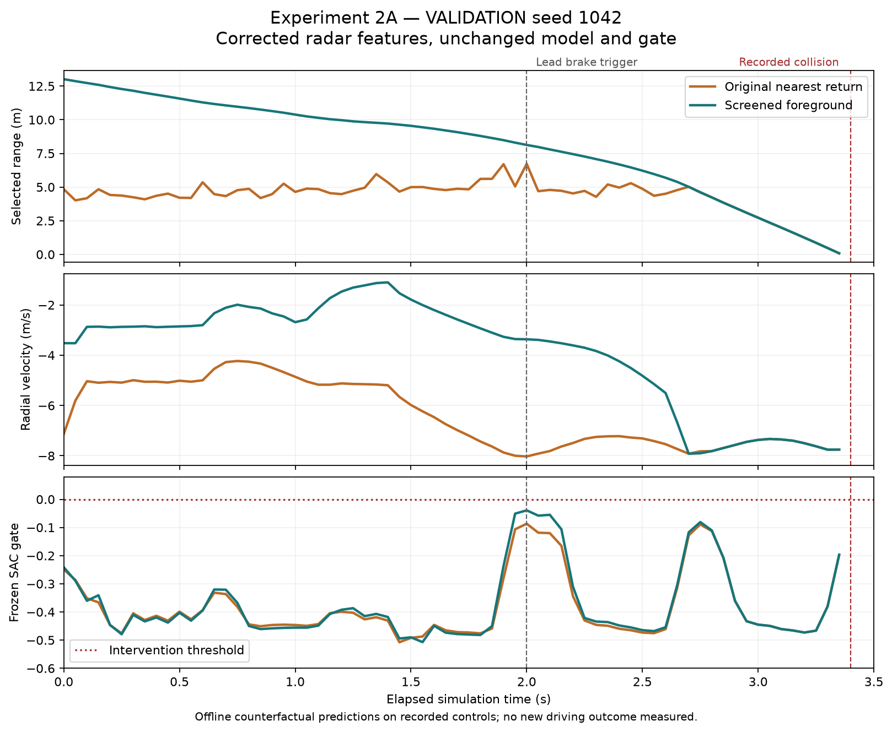

**YA RAB OSTORHA — Experiment 2A: radar correction and inexpensive evidence analysis**

The radar feature-selection defect is repaired in the experimental RL observation
path. The unchanged SAC still requests **zero interventions on the recorded
collision trajectories**. No training or new CARLA episodes were performed, and
no improvement in collision avoidance is claimed. Production driving is unchanged.

**1. Radar before and after**

`backend/rl/radar.py` screens measured radar returns using the audited local mount
position `(2.5, 0, 0.65)` metres and level mounting rotation. It retains a foreground
candidate above 0.25 m before choosing the nearest forward return. The original
forward cone, retained 32 points, measured range/velocity, 47 input dimensions,
history and normalization remain unchanged.

A nominal flat-road screen alone left 17 road selections in the braking VALIDATION
recordings. Rather than increase the height cutoff to fit TEST, the final version
compensates road/body pitch using a bounded consensus plane inferred from the
measured radar points. The plane goes through the nominal ego/road origin; it must
have at least six supporting returns spanning 2 m of depth, residuals within 0.08 m,
and slope at most 0.15. At most 32 returns and 496 pairs are considered. Vehicle
rear-face returns alone cannot satisfy the depth-span requirement in the tested
geometry. Insufficient support falls back to nominal mount-height screening.

No world pose, actor identity, actor transform, bounding box, route, future state,
weather ground truth or reward measurements enter this selector. Native local
mount metadata must match the calibration; missing or changed calibration fails
explicitly. This calibration guard applies only to RL observation assembly.

| Recorded data | Frames | Lead selected before → after | Road selected before → after | No foreground after |
|---|---:|---:|---:|---:|
| VALIDATION frozen SAC, seeds 1042–1045 | 272 | 56 → 272 | 216 → 0 | 0 |
| VALIDATION always-brake, seed 1042 | 240 | 0 → 236 | 240 → 0 | 4 |
| VALIDATION successful script, seed 1042 | 98 | 0 → 97 | 98 → 0 | 1 |
| Historical TEST frozen SAC, seeds 2042–2049 | 544 | 112 → 544 | **432 → 0** | 0 |
| Total | 1154 | 168 → 1149 | 986 → 0 | 5 |

"Lead selected" means offline association with the recorded lead vehicle's box,
with the existing 0.15 m diagnostic tolerance. "Road selected" uses the existing
world-height diagnostic. These labels use ground truth only after sensor-only
feature construction, for measurement, and are never model inputs.

The five no-foreground frames keep foreground validity zero. They are complete,
fresh sensor frames, rather than substituted observations. They do not certify
clear space. Existing numerical padding remains range 50 m / TTC proxy 10 s with
validity zero. The stationary gaps occur at 0.30, 2.65, 5.15 and 6.75 s; the script
gap is at 0.30 s. Low obstacles, steep slopes, sparse radar packets, misestimated
ground planes and objects outside the retained 32 returns remain limitations.
The result does not establish general semantic object detection.

Height sensitivity from 0.10 to 0.50 m gave the same selection counts on VALIDATION
for the final plane screen. This is a local sensitivity check, not evidence that
all those thresholds are safe. The retained 0.25 m value predates this experiment.
[Configuration lock](evidence/experiment2a/validation-lock.json) was written before
the historical TEST audit in each run. The first nominal pass and its result are
preserved under `runs/diagnostics/experiment2a-nominal-screen`; the durable summary
is in [analysis.json](evidence/experiment2a/analysis.json).

**2. Lead-vehicle information timing**

On all four VALIDATION and eight historical TEST collision trajectories, first
lead selection moves from **2.70 s to the initial observation at 0.00 s**. Recorded
impact is at 3.40 s: identification margin rises from 0.70 to 3.40 s. The lead
braking trigger remains 2.00 s, leaving 1.40 s from that trigger to recorded impact.
This is observation timing, not an experimentally measured braking-response gain.

For VALIDATION seed 1042, the original initial selection is a road return at
4.842 m, altitude −0.127798 rad and radial velocity −7.135 m/s. The corrected
selection is at 13.011 m with radial velocity −3.521 m/s. At 2.00 s it is 8.128 m,
−3.367 m/s; at 2.70 s it is 5.017 m, −7.918 m/s. Genuine closing-motion evidence
is available without YOLO or OCR. The retained depth/closing-speed ratio is a
radar proxy, rather than verified bumper clearance or general object TTC.

**3. Observation validity and privileged-information isolation**

All 1168 recorded frames, including 14 initial frames, were complete and agreed
on sensor frame IDs and timestamps. Every transition advanced one native frame.
All 1154 before/after feature vectors have shape `(47,)`, finite float32 values
and existing bounds. Only the four radar-derived columns in each history row
can change; all other columns were checked for exact equality.

Removing actor arrays and ground truth from 42 real frames leaves the policy
features identical. Unit tests reject added privileged fields, wrong/missing
local calibration, world-pose substitution, malformed/nonfinite points and
unsupported packet sizes. Empty screened returns preserve an explicit invalid
foreground indicator. Local-mount metadata and radar points are the selector's
only geometry sources. Ground-truth diagnostic helpers are confined to the
offline measurement script, outside the runtime selector.

**4. Frozen SAC predictions**

The saved actor remains the original SB3 SAC 2.9.0 two-layer 64×64 ReLU model:
47 inputs and three action outputs. It was loaded once per offline pass on CPU,
without optimizer calls, model saving or replay modification.

| Replay group | Positive gates before → after | Corrected gate min / max / mean |
|---|---:|---|
| VALIDATION collision trajectories | 0/272 → 0/272 | −0.50761 / −0.03866 / −0.37328 |
| Historical TEST collision trajectories | 0/544 → 0/544 | −0.50797 / −0.03866 / −0.37307 |
| VALIDATION stationary trajectory | 239/240 → 239/240 | −0.24126 / 0.23344 / 0.16309 |
| VALIDATION scripted success | 41/98 → 41/98 | −0.52634 / 0.23344 / −0.16755 |

Old predictions reproduce the recorded SAC outputs within 1.20e−7. The corrected
brake head on collision frames proposes approximately 0.31–0.49, but the negative
gate suppresses it. There are therefore zero proposals to admit or reject on
those collision snapshots. No gate threshold was changed or biased positive.

These predictions replay recorded prior controls and recorded base proposals.
They do not simulate the new outputs' future states. Stationary/script predictions
are off-policy state probes, not new SAC outcomes. Recorded rewards belong to
the actual recorded actions, never to counterfactual model predictions.

Model SHA-256 remains
`9b3bceb0c77aaea8a6cad71600d36f90b1dfbf2277ffad94ea6b91f42f5ac679`.
Replay SHA-256 remains
`83361806a6a7e69b9da52a6178d94f98e85fdb86b7fc3fe63c3d8ce884b7dfff`.
The model update counter remains 755. The checkpoint, decoder, gate, validator,
arbitration, reward weights, success conditions and CARLA physics are preserved.

**5. Existing model failure: established facts and hypotheses**

The direct reason for no intervention is the deterministic actor's negative gate,
which decodes to the exact base command. The validator did not reject useful
collision-trajectory proposals: none existed. Correcting radar inputs alone
does not repair that saved decision function.

Experiment 1.1 established 556 accepted exploratory interventions in 1255 training
transitions, with one success and one collision terminal reward sample. Training
stopped after only 48 further updates following the collision. The hard gate did
not block all exploration. Many negative gate values decode identically; steering
cannot affect physics without verified side space, despite remaining an entropy
dimension. These are action-design weaknesses, not proof that SAC is incapable.

The new replay exposes an additional state-dependent weakness. On the VALIDATION
script, the actor is negative on the first initial-brake and final-brake decisions,
but positive on 19/20 initial-brake and 21/22 final-brake snapshots after scripted
braking begins. It is also positive on 239/240 stationary snapshots. It responds
in already-braking/stopped states but fails to initiate the tested protective
braking. Reliance on previous braking, IMU or low speed is a plausible explanation;
causal feature attribution and the relative contribution of defective training
observations, sparse terminal learning signals and gate approximation remain
unproven. No synthetic sensor perturbations were used to manufacture that claim.

The 0.15 s observation history also omits the demonstration's persistent phase,
elapsed dwell and integrated odometer. A stateless imitation learner may therefore
have ambiguous targets. Corrected radar changes input semantics without changing
shape, so the existing checkpoint and old replay cannot simply be treated as
trained/calibrated for the corrected features.

**6. Parameters that can reasonably be calibrated**

| Quantity | Evidence-supported analysis | Limit / current decision |
|---|---|---|
| Rule trigger distance | Sensor range and ego speed support `buffer + reaction*v + v²/(2*a)`; inspect false stops and late stops on VALIDATION | Retain proposed script values 3 m, 0.35 s, 5 m/s²; no threshold fit to TEST |
| TTC threshold | Measured radial closing motion permits a valid-foreground TTC-proxy threshold study against VALIDATION outcomes | Range is slant range, not bumper clearance; no threshold selected here |
| Release / hysteresis | Stopped speed, valid range, phase latch and onboard integration explain release and final stop | Retain 1 s diagnostic dwell, <0.2 m/s stop condition, 6 m range floor; not a universal driving rule |
| Brake / steering bounds | Accepted full-brake trajectories demonstrate this actuator/admission path | One stroke cannot calibrate weaker braking; steering stays zero without side evidence |
| Observation normalization | VALIDATION extrema/clipping are logged; 37/610 latest acceleration features reach ±1 | Keep existing scales; changing them invalidates frozen-model equivalence and requires a separate version |
| Action gate | VALIDATION teacher decisions permit future false-positive/false-negative and calibration studies | Stationary positives and missed trigger negatives undermine a simple threshold fix; no gate shift performed |
| Reward weights | Recorded component vectors permit sensitivity and preference inequalities such as safe-progress return > stationary return | No weight fitting or changes; finite trajectories cannot prove global reward optimality |
| Training hyperparameters | Event counts, update exposure and rollout cost can guide later data coverage / warmup / batch plans | One short failed run cannot identify a good learning rate or entropy setting; no search performed |

In the VALIDATION final brake, speed falls from 8.027 to 0.018 m/s in 0.65 s over
3.659 m of integrated onboard travel. Energy-equivalent deceleration is 8.805 m/s²;
mean speed deceleration is 12.323 m/s². These are different measures of one varying
brake stroke, not interchangeable constants. The teacher's existing 5 m/s² value
is lower than the observed energy-equivalent value; retain it as a conservative
prototype hypothesis rather than fit it upward from one success.

Unchanged VALIDATION returns are safe progress **+36.6633**, stationary **−5.2580**,
collision **−243.0544**. Safe progress includes +13.4686 progress, +25 completion,
−1.36 delay, −0.3503 smoothness and −0.095 unnecessary braking. The tested reward
ranking is appropriate. Sparse terminal credit, BasicAgent contributions to
final-control smoothness, and positive incomplete progress remain diagnosis
concerns. Nineteen initial demonstration braking steps are labeled unnecessary
by the current heuristic. Their physical necessity was not established by an
ablation, so the demonstration should not automatically be treated as an optimal
teacher. No reward changes are justified solely to make a new score attractive.

**7. Successful scripted demonstrations and proposed teacher**

| Historical seed / split | Initial brake | Release | Final brake | Outcome / progress / minimum clearance |
|---|---:|---:|---:|---|
| 1042 / VALIDATION | 0 s | 1.00 s | 3.80 s | SUCCESS / 13.469 m / 8.138 m |
| 2042 / historical TEST | 0 s | 1.00 s | 3.80 s | SUCCESS / 13.459 m / 8.256 m |
| 2043 / historical TEST | 0 s | 1.00 s | 3.75 s | SUCCESS / 13.477 m / 8.135 m |

Each lasts 4.9 simulation seconds. Initial braking is a scripted diagnostic prior,
not a learned recognition decision. Release requires dwell ≥1 s, ego <0.2 m/s and
measured range beyond the stopping envelope. In VALIDATION the release range is
14.497 m. Release restores progress rather than remaining stationary.

Final braking is triggered by range entering the envelope: 11.727 m versus
12.254 m in VALIDATION at 8.027 m/s. Integrated travel is 9.865 m, below the
10.75 m odometer guard. The range condition, rather than that guard, triggers final
braking in all three demonstrations. Final braking and the latched stop allow the
unchanged safe-approach completion condition. The lead never resumes moving.
These phase observations explain the executed mechanism; they do not prove that
each individual earlier braking action was necessary.

[teacher-proposal.json](evidence/experiment2a/teacher-proposal.json) describes a
separate **POSTHOC_RULE_TEACHER_PROPOSAL_V1**, with three states and the original
understandable stopping-envelope parameters. It is a proposal, not installed or
executed code and not RL learning. It uses measured range, ego speed, relative
sensor time and onboard odometry, zero steering, and the existing admission path.
No actor geometry or reward fields may be consumed.

The corrected range changes four instantaneous safe-range predicates on the
VALIDATION script, all during phases already latched in braking. Offline phase
replay still matches **98/98 recorded intervention decisions**. This supports a
small teacher candidate; it does not establish a fresh native result. Parameters
were not optimized across the three seeds. The two TEST successes are historical
descriptions only. A new teacher requires matched native VALIDATION trials and
fresh TEST seeds before claiming safety improvement.

**8. Cheapest valid next experiment and lightweight learning options**

Recommended order, combining expected safety value, evidence, cost, implementation
effort and interpretability:

| Rank / option | Expected safety value and supporting evidence | Compute / complexity | Scientific interpretation |
|---|---|---|---|
| **1 / B: separate rule supervisor** | Best-supported candidate: three historical native successes, 98/98 VALIDATION replay agreement | Small CPU controller; short matched native pilot; modest implementation | Explicit range envelope, release and stopping state; separately labeled post-hoc control |
| 2 / C: small behavior-cloned policy | Promising after teacher validation and a distinct TRAIN demonstration set; not demonstrated yet | Cheap offline CPU training, plus necessary native evaluation; dataset/state work | Supervised imitation of admitted interventions, not reinforcement learning |
| 3 / A: frozen SAC with corrected radar | Input selection improved; zero collision-state gates persist | Cheapest replay already completed; minimal integration work | Clean feature intervention, no evidence of useful new safety decisions |
| 4 / D: short warm-started RL | Uncertain benefit with sparse events, partial state and discontinuous action gate | Highest native sample cost; more implementation and validation | Learned improvement must be demonstrated independently; no present evidence |

For a future learning policy, CPU behavior cloning from an independently validated
teacher best matches the supervisor role: learn NO_INTERVENTION versus additional
braking while BasicAgent keeps navigation and the validator keeps admission.
Behavior cloning optimizes supervised observation/action labels; it is **not RL**.
Its generalization and recovery limitations require explicit native evaluation.
[Official imitation BC documentation](https://imitation.readthedocs.io/en/latest/algorithms/bc.html).

The three diagnostic successes contain only one VALIDATION episode and two already
inspected TEST episodes; they are not a clean TRAIN dataset. Preserve those splits.
Future teacher demonstrations should be collected on TRAIN conditions with both
intervention and no-intervention/release examples. Keep raw proposed and admitted
actions, failure/recovery episodes, and component returns; episode reward alone
should not label every action good. The diagnostic initial dwell is not an optimal
hazard policy, and persistent onboard state must be represented before attempting
to clone its phases. Otherwise a 47-input stateless MLP can fit contradictory
short-history targets. Small CPU policies are plausible; none was built or trained.

Offline replay is useful for feature validity, command admission, label agreement,
latency and reward decomposition. It cannot evaluate the physical consequence of
changed actions. Imitation can visit states outside its demonstration distribution,
so future recovery coverage matters. [Primary DAgger paper](https://proceedings.mlr.press/v15/ross11a.html).

Warm-starting from a later validated imitation actor may reduce costly exploration.
Directly resuming the old SAC replay would mix old ground-contaminated inputs with
the new semantics unless TRAIN observations are reconstructed from their real
sensor recordings. Rewards remain tied to the recorded applied controls. Short RL
fine-tuning would still need separate authorization, a bounded budget and unchanged
comparison conditions. Model-free RL can require substantial samples; feature and
controller validation should precede another hyperparameter search.
[Official SB3 guidance](https://stable-baselines3.readthedocs.io/en/master/guide/rl_tips.html).

**9. Actual resources**

Two offline passes consumed **55.723 s wall time and 52.250 CPU seconds** in total.
The final pass took 28.618 s. Its peak sampled private memory was **817.48 MiB**,
peak sampled RSS 293.61 MiB, and OS peak working set 297.55 MiB, including Torch/SB3
imports. CPU inference used two Torch threads and one interop thread; CUDA was
unavailable in the installed CPU Torch build. **New model GPU allocations: zero;
training updates: zero; native episodes/physics steps: zero.**

The two small reward/demo/latency analyses took 2.214 and 2.319 s wall time,
1.375 and 1.438 CPU seconds after their imports, with about 56.3 MiB peak working
set. The final full 47-feature projection benchmark, 512 repetitions of an actual
four-frame VALIDATION history, measured median **1.278 ms**, p95 **2.621 ms** and
maximum 9.212 ms, versus legacy median 0.134 ms / p95 0.259 ms. This is added CPU
work well below the 50 ms timestep in this sample; it is not a hard latency bound.
Two batched frozen predictions per replay group together took 10.69 ms across the
final pass; these are batch timings, not single-action native latency measurements.

The existing CARLA/desktop GPU snapshot was 5883/6144 MiB, with 36% utilization
at verification. It was already running and is outside incremental analysis costs.
No graphical settings were changed. The Python suite took 7.164 s and JavaScript
tests 0.351 s internally; plot generation took about 2.94 s as observed by the
command runner. Total development/chat wall time and aggregate regression CPU
time were not instrumented. No claim is made that they equal analysis wall time.
Sensor binaries were not copied: evidence stores small feature arrays and replay
summaries pointing to the original real recordings. YOLO and OCR were not used.

**10. Tests and native validation**

162 Python tests ran: **161 passed, one skipped** because the native CARLA API is
installed and its absence test is inapplicable. All **24 JavaScript tests passed**.
The five new radar tests cover geometry screening, calibrated mounts, shape and
validity, privileged-field isolation, bounded pitch compensation and invalid data.
Offline checks additionally cover the 1154 vectors, 1168 synchronized frames,
42 real-frame isolation comparisons, old prediction fidelity and file hashes.

No new native episode was run: authentic recordings answer the feature-selection
and frozen-prediction questions without changing actions or physics. Existing
Experiment 1.1 native results remain historical evidence. New controller safety,
new actor-cleanup behavior, and native latency/memory after this change have not
been newly measured. No second CARLA client or tick owner was created. Read-only
live verification shows connected, PAUSED, no error, RL lease inactive, no pending
RL requests, tick owner `simulation-worker`, and learned policy inactive.
[Verification](evidence/experiment2a/verification.json).

**11. Files, Git and preservation**

Starting HEAD: `3d3684f7dfa855b7170c241962e6b7f646f37435`; working branch:
`codex/experiment2a-radar-fix`. No older reset was performed. Existing README,
population, urban, normal-city documentation, restart/verifier and population-test
edits were preserved byte-for-byte in their original tracked patch. The untracked
Gate 5 verifier also matches its recovery copy. Recovery files are under
`output/experiment2a-preserved`. Existing commits, models, logs and recordings remain.

Changed runtime files: new `backend/rl/radar.py`, the radar selection call in
`backend/rl/supervisor.py`, and the calibration guard in `backend/rl/observations.py`.
Test changes: calibrated fixture in `tests/test_rl.py`, new `tests/test_rl_radar.py`.
Analysis additions: `evaluate_experiment2a_offline.py`,
`summarize_experiment2a_evidence.py`, `plot_experiment2a.py`, this report and
`docs/evidence/experiment2a/`. The existing rule baseline retains its original
selector to preserve comparison identity. A future teacher is separately versioned.
No production service, vehicle physics, safety validator, controller, reward or
scenario implementation was changed.

Reproduce offline analysis with `.venv-rl/Scripts/python.exe -m
scripts.native.evaluate_experiment2a_offline`, followed by
`scripts.native.summarize_experiment2a_evidence` and `scripts.native.plot_experiment2a`
using the same module invocation. These commands read recordings and run frozen
inference; they do not train or tick CARLA. The analysis outputs retain the source
HEAD used before the final scoped commit. The final commit hash is reported in
the task completion message to avoid embedding a self-referential hash here.

**12. Experiment 2B recommendation**

Authorize **B: a separate three-phase rule-based teacher validation**, using the
corrected radar and the proposal above, with the existing feasibility/admission
path. First run a small matched VALIDATION pilot against BasicAgent and frozen
SAC, with locked settings and a strict episode/time cap. Check unnecessary braking
and release as well as collision avoidance and safe progress. Use fresh TEST seeds
only after calibration is locked; the old eight TEST seeds have informed diagnosis
and are not an untouched benchmark anymore. This is the cheapest defensible next
step before investing in a clean TRAIN imitation dataset or further RL.

Experiment 2A stops here. No new controller was executed, no weights or rewards
were tuned, and no training or Experiment 2B was started.
