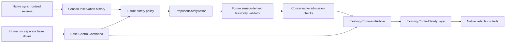

# Gate 5 environment and future safety-policy contracts

YA RAB OSTORHA is a safety layer for a human or separate baseline driver.
Gate 5 contains no learned policy, neural network, reward weights or training loop.
The pre-existing explicit BasicAgent journeys and read-only perception are
preserved features, not implementations of YA RAB OSTORHA.

## One simulator, two logical environments

`CarlaProvider` owns the existing simulator connection, ego, seven sensors,
population manager and one simulation worker. `LIVING_CITY` permits continuous
native background traffic and manual driving. `TRAINING` isolates a controlled
scenario on the same world and worker, including validation/test episodes.
Changing background settings or routes during a controlled scene is rejected.
Recording blocks resets, sensor reconfiguration and environment changes.

`ScenarioLifecycle` supplies load/reset/start/step/stop/collect_outcome/cleanup.
The native manager reuses the provider's ego/sensor reset and owned actor cleanup.
It requires the live map to match the specification; managed map restart remains
the existing Windows process-retirement path. Failed strict spawns do not fall
back to a different initial condition.

The specification records identity/type/seed/map, ego spawn and initial speed,
vehicle control schedules, pedestrian definitions, weather, density, difficulty,
success/failure conditions, timeout, split and metadata. Initial speed is assigned
once at episode start as a physical initial condition. Subsequent driving uses
native physics and vehicle controls. No background vehicle is teleported.

Front Obstacle and Sudden Braking are the two native demonstrations. Seven other
families have contracts and are rejected until a verified native factory exists.
The demonstrations default to a stopped ego and require a base driver to approach
the hazard. Their difficulty label does not change their fixed geometry.
Pedestrian definitions are not yet admitted by the native scenario adapter.

Actual settled/start poses, velocities, bounding boxes, applied controls, weather,
sensor registry, API/server versions, timestep, rendering configuration and setup
durations accompany each run. Canonical specification and actual-state hashes
support matched runs. Identical seeds are not an unconditional physics guarantee.
Outcome JSON is saved under `output/scenarios`; recordings retain scenario
metadata and finish events. Positive progress is required for success.

## Future policy boundary

The diagram describes a prepared integration path. Policy and physical hazard
validator interfaces have no running implementation. Existing watchdog braking
remains separate. The dashboard explicitly reports `INTERFACE_PREPARED_NO_POLICY`.

`SensorObservation` contains synchronized RGB/depth/LiDAR asset references,
radar/IMU readings, optional GNSS, sensor calibration and onboard speed/control
state. Angular velocity comes from native IMU gyro in its sensor-local frame.
History is bounded to four frames by default, cleared at resets/incomplete data
and broken across excessive gaps. Global sensor transforms, exact actor poses,
actor IDs, privileged ground truth, predictions and future trajectories are
excluded. Asset bytes are retrieved through the existing sensor-asset interface.
Privileged `SimulationFrame` data remains available to setup, recording,
diagnostics, rewards and evaluation; it is not the policy input.

Proposals reuse normalized `ControlCommand` steering/brake/throttle. Admission
requires fresh evidence for physical limits and surrounding hazards. Steering
requires confirmed space on its requested side; increased throttle requires
a confirmed acceleration path. Missing evidence rejects the proposal. Gear,
reverse and handbrake changes require another validated contract. No contract
claims to prove collision avoidance from these flags alone. A real validator
must compute the evidence and pass accepted controls through existing arbitration.

## Curriculum and research

`config/curriculum.json` declares all six requested levels with entry and
progression criteria. Thresholds are explicitly proposed, not validated research
findings. Progression rejects incomplete or invalid measurements. Native coverage
currently extends only to the two introductory vehicle prototypes.

TRAIN, VALIDATION and TEST use disjoint reserved seed ranges 0–999, 1000–1999 and
2000–2999. Seed separation alone does not prove generalization; factories still
need unseen positions, actor combinations, density, speed, pedestrian and weather
variations. `ComparisonRun` requires a held-out split and matching scenario,
actual initial state and reproducible base-driver protocol. Human exploratory
driving is not a matched research baseline. Use an identified scripted trace or
the same identified baseline agent with and without a real policy.

All eight reward components have nullable values and unset weights. Outcome
data records actual progress/distance/time/control variation and native collision
callbacks/episodes/impulses. Native impulse is a severity proxy, not injury or
kinetic energy. Planar oriented-box clearance excludes pitch, roll and detailed
meshes. TTC, near misses, intervention necessity, unsafe interventions and rates
remain null until a valid estimator/protocol exists. Physically unavoidable
classification remains UNKNOWN until independent reviewed physical evidence is
provided. No enabled-policy result exists.
