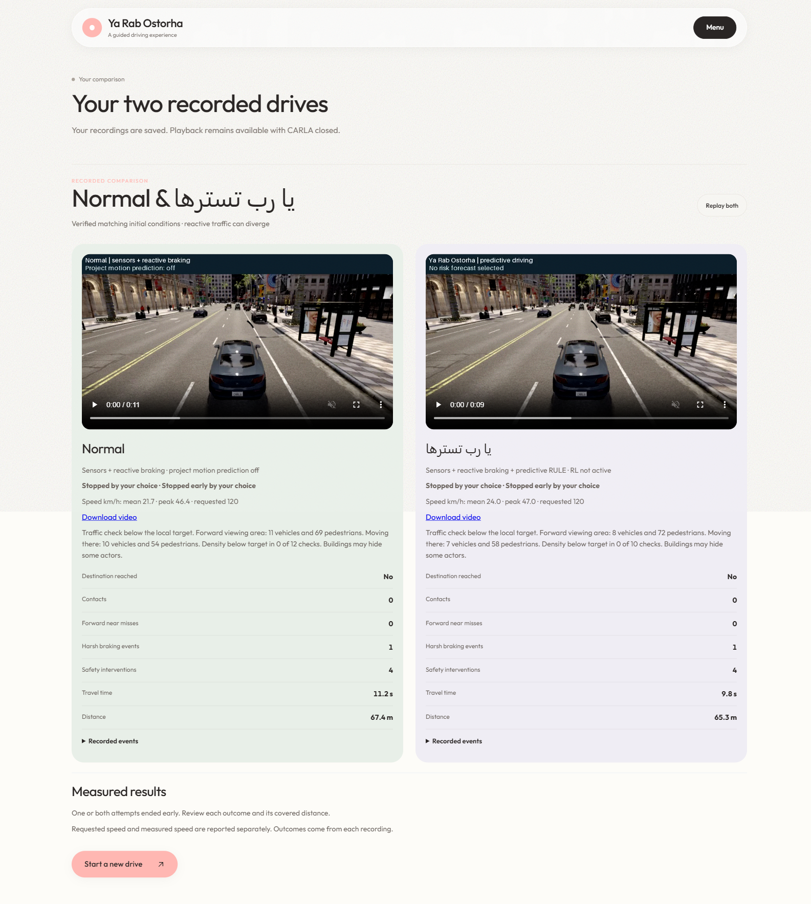
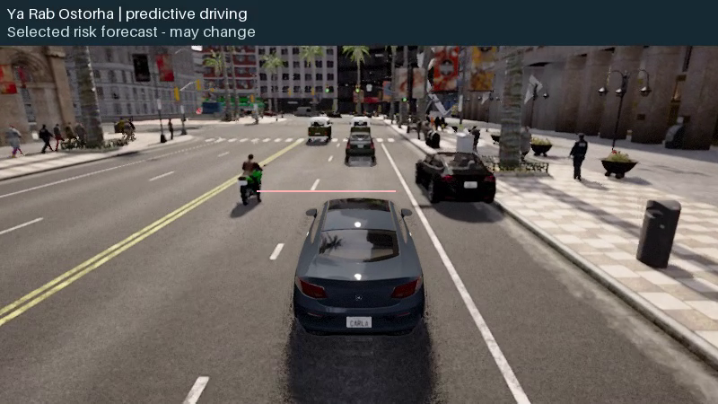

# Guided loading, 120 km/h target and retained results — 19 October 2026

The guided experience retains Town10HD_Opt, the Mercedes and the Softly theme.
Both drivers now request **120 km/h**. Actual speed still follows measured road
coverage, route geometry, traffic signals and hazards. Normal retains reactive
sensor braking; **يا رب تسترها** adds predictive RULE. Internal `ROBOSPHERE`
identifiers and historical driver metadata remain intact. RL is not active.

This revision supersedes the earlier 80 km/h guided target, automatic takeover
on opening a new page, illustrated safe stop for both drivers, and Finish that
hid the comparison. Earlier reports retain their original observations.

## Operation and results

- Start stays mounted through car selection, sensor verification and recording
  preparation. A continuous spinner accompanies actual native phase descriptions;
  there is no measured-percentage claim. Reduced motion keeps a static indicator.
- A command stays pending until its acknowledgement and the corresponding
  attempt/phase transition arrive. Repeated selected Start, Next and Finish are
  idempotent on the server. Stale commands cannot finish another presentation.
- Visiting a second dashboard observes the active attempt. Explicitly preparing
  a new drive elsewhere remains the action that saves/stops the old attempt.
  Tab-local identity survives refresh. Menu/focus changes retain automatic
  driving and its existing heartbeat checks; manual input still disarms.
- A live transport during preparation is distinguished from missing fresh
  sensor data. Real faults show a cause and recovery action. Normal transitions
  do not show an `Interrupted` status. Historical outcome codes remain recorded.
- Results contain Normal and يا رب تسترها videos with names below, independent
  export placeholders and downloads. Finish enters `FINISHING`, waits for sealed
  recordings and both required annotated exports, saves the comparison reference,
  closes CARLA, and verifies process exit. Export failure retains the result and
  offers explicit retry. Export workers deduplicate by recording root.
- The SDK-free stopped host receives the saved presentation/reference. Videos
  remain mounted during Finish and playback survives simulator exit and page
  refresh. Only **Start a new drive** starts the next comparison. The archive's
  new-drive button cannot accidentally dispatch the active drive's Next command.

The final native check specifically requested Finish while the second MP4 was
still `ENCODING`. It waited, closed CARLA and played both MP4s afterward. Refresh
was checked both before Finish and after native shutdown.



## Control and forecast display

The guided preparation/admission/driver chain carries the same 120 km/h request.
The forward coverage probe now covers the speed-dependent stopping envelope,
bounded by configured sensor range. Its measured occupancy grid expands to that
scope, capped at 100 m; unknown cells remain unknown. Repeated fusion for the
same scene and steering/path intent reuses its result, bounded to that frame.
Crossing conflict checks use the speed-dependent stopping horizon instead of a
fixed three-second ego path. Sensor/control freshness, signal braking and release
hysteresis are unchanged.

The main camera receives a small selected forecast from the control scene after
actuation. It does not request a competing supplementary prediction calculation.
The same forecast enters the recording trace. Main view and derived MP4 draw at
most one selected hazard trajectory plus one actually selected avoidance path;
Menu retains full diagnostic hypotheses. Selected maneuver timestamps, pose and
0.1 s freshness are preserved in both renderers. No selected risk is a valid
empty overlay, distinct from unavailable forecast data.

The introductory animation deliberately shows Normal braking late and contacting
the person; the project car stops early, waits and continues. It is an illustration.
Native contact counts always come from actual collision events. No safety brake
was removed to manufacture a collision in Normal.

The final project-first native city run recorded six frames of
`PEDESTRIAN_POSSIBLE_START`. At the first frame, forward measured clearance was
11.17 m versus an 8.44 m reactive stopping envelope; the base driver requested no
brake. RULE submitted braking for a possible crossing at 1.4 s. The physical
brake appeared on the next frame and was subsequently released. This verifies a
real predictive intervention before a reactive-range trigger, **not knowledge of
the person's intent or proof of an avoided crash**. All six recorded trajectories
match the applied risk trajectory exactly. The annotated video contains six
forecast frames and 192 valid frames without a selected risk, with no missing
forecast frames.



## Native observations and limits

Two ordinary guided comparisons ran through the real dashboard in both orders.
All four attempts were explicitly shortened after their recording interval;
they are not completed-route acceptance. Both reconstructed pairs matched their
initial-condition checks, had zero recorded contacts and no terminal technical
interruption. The final project-first run also opened another native page during
driving and verified that the current attempt continued.

| Order | Driver | Distance | Simulated time | Mean / peak km/h | Median native Hz |
| --- | --- | ---: | ---: | ---: | ---: |
| Normal first | Normal | 123.79 m | 18.25 s | 24.37 / 49.80 | 7.52 |
| Normal first | يا رب تسترها | 89.12 m | 12.20 s | 26.25 / 48.99 | 4.97 |
| Project first | يا رب تسترها | 65.28 m | 9.75 s | 24.02 / 47.02 | 5.72 |
| Project first | Normal | 67.41 m | 11.15 s | 21.69 / 46.42 | 6.30 |

Recorded stop review found one >=0.5 s stationary segment per arm: the initial
0.65 s hold. Processing-deadline holds are counted separately from measured or
predicted hazard decisions: respectively 1/5 frames in the first pair's
Normal/project runs and 0/1 in the final pair's project/Normal runs. They did not
end these attempts. Raw logs are retained, including lossless telemetry archives
created by the existing storage-retention policy. Ordinary drives did not record
an independent native oracle, so logged reasons alone cannot certify every
braking decision or stop necessity.

**Full real-time throughput, actual 120 km/h travel, comfort, dense-scene quality
and general collision avoidance remain unaccepted.** The 120 target is verified;
the measured city speeds above are the actual results. The 5–8 Hz native rate is
still below the requested 20 Hz. No timing/freshness guard was relaxed to hide it.

### Repeatable physical crossing

The evaluator uses Town10HD_Opt spawn 152, the same Mercedes, ordinary sensor rig,
fixed seed 1701, initial pose, weather and physical WalkerControl schedule for
both arms. Schedules and native truth stay evaluator-only. The production-driver
option applies a resource/time bound without enabling ticket-only experimental
RULE bypass. It does not reset a research ledger.

The accepted scoped case starts the person 14 m ahead and 1.8 m laterally from
the initial ego, schedules crossing at 4 s and requires measured movement through
to the opposite 2 m clearance. Both drivers arrived after 43.51 m, with zero
contacts and a 30.54 km/h peak for a 30 km/h request. Both stopped and resumed;
their first sensor-braking time was the same, 2.40 s. **This crossing verifies
release/progress, not an earlier predictive onset or superiority over Normal.**

Two other paired fixture attempts are retained. At the original 4 m sidewalk
offset, the person moved partially then remained blocked by native road geometry;
the old partial-motion validity gate could label that a crossing. Its ticket also
admitted experimental bypass and the project arm did not arrive. At the opposite
-3.5 m offset, the strengthened complete-crossing gate correctly rejected both
cases despite arrivals and zero contacts. Neither is counted as a successful
crossing. The original reports, source ZIP hashes, videos and failures survive.

Reproduce the scoped production case with the ordinary dashboard stopped:

```powershell
.\.venv-carla\Scripts\python.exe -m scripts.native.validate_sensor_comparison --seeds 1701 --scenarios PEDESTRIAN --seconds 900 --sim-seconds 30 --speed 30 --pedestrian-delay 4 --pedestrian-lateral 1.8 --ordinary-sensors --production-drivers
```

## Verification and evidence

- `npm run build:dashboard`: passed; checked-in JS and CSS regenerated.
- `npm test`: **172 passed**.
- Python discovery: **692 discovered, 690 passed, two optional skips**.
- Isolated browser: **28 checks passed**, including double Start/Finish,
  delayed export, observer state, loader stages, reduced motion, Menu, refresh,
  actual retained MP4 playback and 1440/390/320 px layouts without overflow.
- Native lifecycle: **9 Normal-first and 12 project-first checks passed**.
  Actual MP4 hashes were verified for all four runs. Their browser playback
  after CARLA exit and refresh was checked.
- Offline regressions verify early/cleared crossing decisions, extended horizon,
  frame-local cache, unknown space, exact selected risk, two-path maximum and
  maneuver expiry in the main/video renderers. Final command-acknowledgement,
  observer/reconnected Finish and maneuver-clock hardening have browser/offline
  verification; the recorded native city intervention used one risk path and no
  selected avoidance maneuver.

The browser fixture uses real static assets and retained native MP4s but simulated
session transitions. Its screenshots are labeled separately from actual native
evidence. No live-driving claim comes from fixture rendering.

Evidence index:

- [Verification and source identities](evidence/guided-flow-repair-20261019/verification.json)
- [Browser checks](evidence/guided-flow-repair-20261019/browser.json),
  [mobile fixture](evidence/guided-flow-repair-20261019/isolated-results-mobile.png)
- [Normal-first native summary](evidence/guided-flow-repair-20261019/native-normal-first.json),
  [project-first native summary](evidence/guided-flow-repair-20261019/native-project-first.json)
- [Stops and actual anticipation](evidence/guided-flow-repair-20261019/stops-and-anticipation.json),
  [video consistency and checksums](evidence/guided-flow-repair-20261019/video-consistency.json)
- [All three crossing pairs](evidence/guided-flow-repair-20261019/native-crossings.json),
  [retained lifecycle/browser failures and corrections](evidence/guided-flow-repair-20261019/retained-failures.json)

Raw runs, MP4s, diagnostic source archives, local models and environments remain
outside Git. The stopped dashboard currently retains comparison
`a9b856ca31d4433ab783b0cb3973cd43` and its two playable videos.
